<h1 align="center">compose-lab</h1>

<p align="center">
Compose Multiplatform components, rebuilt from scratch and recorded as short clips.<br>
One Kotlin codebase, the same pixels on Android and iOS.
</p>

<p align="center">
  <a href="https://github.com/DimiVlachos/compose-lab/actions/workflows/ci.yml"></a>
  <a href="LICENSE"></a>
  
  
  
</p>

<p align="center">
  <a href="#nav-bar-corepresentationcomponentsnavbar">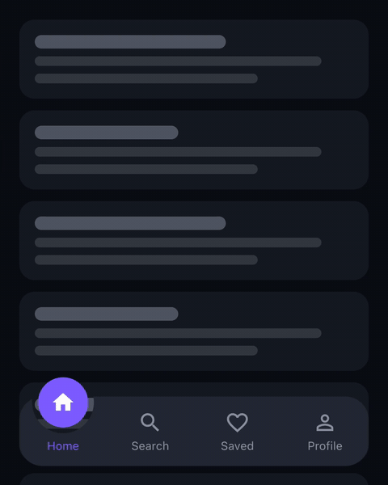</a>
  <a href="#fogged-mirror-corepresentationcomponentsfog">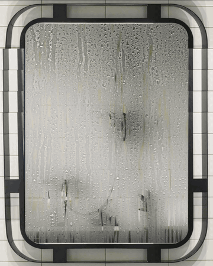</a>
  <a href="#paper-plane-corepresentationcomponentspaperplane">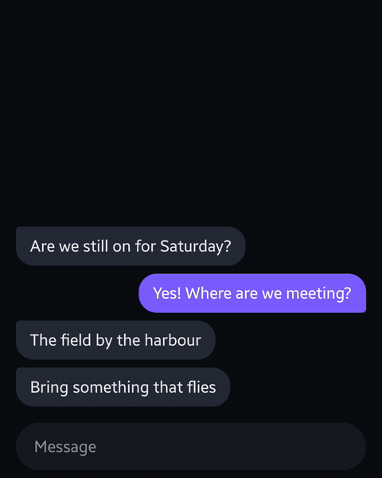</a>
</p>

Each component lives in its own package under `composeApp/src/commonMain/kotlin/dev/dimvlachos/lab/core/presentation/components/`, has a demo that plays a timed script, and is covered by common tests that run on the iOS simulator in CI.

| Component | Package | Demo | What it shows |
|---|---|---|---|
| [Nav bar](#nav-bar-corepresentationcomponentsnavbar) | `navbar` | `navbar.all` | A bottom bar of switchable layers: morphing indicator, cutout, collapse on scroll, jelly action button |
| [Profile gallery](#profile-gallery-corepresentationcomponentsgallery) | `gallery`, `imagemorph`, `profile` | `morph.app` | Every open is a shared-element morph, serialised by a morph gate |
| [Fogged mirror](#fogged-mirror-corepresentationcomponentsfog) | `fog` | `fog.mirror.bathroom`, `fog.mirror.camera` | Wipe steam off a mirror; running drops; your live face, cut out on the phone |
| [Page-turn book](#page-turn-book-corepresentationcomponentspageturn) | `pageturn` | `book.turn` | Pages that curl in 3D under the finger, in plain `DrawScope` |
| [Paper plane](#paper-plane-corepresentationcomponentspaperplane) | `paperplane` | `chat.plane` | A chat that sends each message as a folded paper dart |
| [Pull cord](#pull-cord-corepresentationcomponentspullcord) | `pullcord` | `lamp.cord` | Pull a lamp's cord to switch a screen between light and dark |
| [Magnet filter](#magnet-filter-corepresentationcomponentsmagnet) | `magnet` | `magnet.filter` | Drag tag magnets over photos to filter them; snap two together to search for both |
| [Fishing refresh](#fishing-refresh-corepresentationcomponentsfishing) | `fishing` | `feed.fishing` | A pull-to-refresh that isn't a boring spinner: cast a line, haul new cards up from the deep, reel in an empty hook, or snap the line |
| [Pop-up book](#pop-up-book-corepresentationcomponentspopup) | `popup` | `tour.popup` | An onboarding as a pop-up book: paper scenery stands up as a spread opens, and pull tabs sail a boat and spin windmill sails |
| [Typewriter composer](#typewriter-composer-corepresentationcomponentstypewriter) | `typewriter` | `typewriter.composer` | A chat composer that is a typewriter with its own round keys: letters strike the paper, the bell rings at the margin, and you pull the sheet out to send |
| [Smoke delete](#smoke-delete-corepresentationcomponentssmoke) | `smoke` | `smoke.delete` | Swipe a chat away and it burns from the edge into smoke that curls up over the list; mist for the archive; Undo breathes it back |
| [Snow globe](#snow-globe-corepresentationcomponentssnowglobe) | `snowglobe` | `snowglobe.weather` | A weather screen whose snow globe refreshes the forecast when shaken: glitter swirls through real refracting glass, over Oia's caldera |
| [Card file](#card-file-corepresentationcomponentscardfile) | `cardfile` | `cardfile.contacts` | Contacts on a chrome rotary card file: spin the cards with momentum, tap a letter tab, pull a card out to call or message |
| [Bookshelf](#bookshelf-corepresentationcomponentsbookshelf) | `bookshelf` | `bookshelf.reading` | A reading list on real shelves: books on a ring that spins and on oak planks; tip one out by its spine and it opens at your bookmark, its pages turning like paper |
| [Paper bag cart](#paper-bag-cart-corepresentationcomponentspaperbag) | `paperbag` | `paperbag.cart` | A cart icon that is a kraft grocery bag: things hop in on an arc, poke out of the top and fill it out, the count is rewritten in grease pencil, and the bag tips open over what is in it |
| [Star stickers](#star-stickers-corepresentationcomponentsstickers) | `stickers` | `stickers.rating` | A star rating on a teacher's sheet of gold foil stickers: drag across and each star peels off, flies up and is pressed into its slot |
| [Mailbox badge](#mailbox-badge-corepresentationcomponentsmailbox) | `mailbox` | `mailbox.badge` | An inbox button that is a tin rural mailbox: mail slips in through the door, the red flag swings up with the count painted on it, and comes down once everything is read |
| [Padlock](#padlock-corepresentationcomponentspadlock) | `padlock` | `padlock.password` | A password's strength meter and show/hide switch as a brass padlock: the shackle lowers and turns to steel as the password gets stronger, and drops home with a clunk at strong |
| [Pencil cup FAB](#pencil-cup-fab-corepresentationcomponentspencilcup) | `pencilcup` | `pencilcup.fab` | A speed-dial + button that is a cobalt-glazed pencil cup: its tools leap out in a fan as the actions, and the one picked rides in a pocket on its new sheet while the rest clatter back in |
| [Locket avatar](#locket-avatar-corepresentationcomponentslocket) | `locket` | `locket.avatar` | A profile photo picker as a gold locket on a fine chain: tap the catch and it springs open, drag a photo in and it trims itself to the oval, and it snaps shut with a swing of the chain |
| [Birdcage](#birdcage-corepresentationcomponentsbirdcage) | `birdcage` | `birdcage.mute` | A chat's mute switch as a brass birdcage: messages make the canary sing, and pulling a linen cover over the cage mutes the chat and puts the canary to sleep |
| [Zipper scrollbar](#zipper-scrollbar-corepresentationcomponentszipper) | `zipper` | `zipper.scrollbar` | A long list's fast scroller as a brass zipper sewn down its edge: the list opens behind the pull as you go down, and a cotton tag on the pull shows the letter |
| [Key hook sign-out](#key-hook-sign-out-corepresentationcomponentskeyhook) | `keyhook` | `keyhook.signout` | An account switcher that is the key rack by the front door: hang your keys on the rack to sign out, carry someone's set up to the account card to sign in |
| [Paper fan](#paper-fan-corepresentationcomponentspaperfan) | `paperfan` | `paperfan.faq` | An FAQ whose expand arrows are folded paper fans: tap a question and its fan snaps open across the card with the answer printed on its pleats |
| [Sticky note swipe](#sticky-note-swipe-corepresentationcomponentsstickynote) | `stickynote` | `stickynote.swipe` | Swipe actions on a list row: each reminder is a sticky note that peels from the corner over Archive or Snooze and sticks to a Done or Later pad |
| [Paint roller accent](#paint-roller-accent-corepresentationcomponentspaintroller) | `paintroller` | `paintroller.accent` | An accent colour picker as five paint trays and a roller: roll a new colour up the settings screen and every accent fill it passes takes the wet paint, then dries |
| [French press summary](#french-press-summary-corepresentationcomponentsfrenchpress) | `frenchpress` | `frenchpress.summary` | A Summarize button that is a little glass French press: push the plunger and the story's words pour in as grounds, and a three-point summary pours out into a card |
| [Photocopier duplicate](#photocopier-duplicate-corepresentationcomponentsphotocopier) | `photocopier` | `photocopier.duplicate` | A list's Duplicate as a little office copier: the card goes face down on the glass, the light sweeps under the lid, and a warm copy slides out of the slot into the list right under it |
| [Pigeonhole move](#pigeonhole-move-corepresentationcomponentspigeonhole) | `pigeonhole` | `pigeonhole.move` | Move to… in a mail app as an oak sorting rack: the email folds into a letter and is posted into a cubby |
| [Moodboard](#moodboard-native-on-both-platforms-moodboard) | `moodboard/` | showcase | A KMP app that shares logic and keeps each platform's UI native |

The scripted fingertip in every clip is `touch/ScriptedTouch.kt`.

<details>
<summary><b>Contents</b></summary>

- [Nav bar](#nav-bar-corepresentationcomponentsnavbar)
- [Profile gallery](#profile-gallery-corepresentationcomponentsgallery)
- [Fogged mirror](#fogged-mirror-corepresentationcomponentsfog)
- [Page-turn book](#page-turn-book-corepresentationcomponentspageturn)
- [Paper plane](#paper-plane-corepresentationcomponentspaperplane)
- [Pull cord](#pull-cord-corepresentationcomponentspullcord)
- [Magnet filter](#magnet-filter-corepresentationcomponentsmagnet)
- [Fishing refresh](#fishing-refresh-corepresentationcomponentsfishing)
- [Pop-up book](#pop-up-book-corepresentationcomponentspopup)
- [Typewriter composer](#typewriter-composer-corepresentationcomponentstypewriter)
- [Smoke delete](#smoke-delete-corepresentationcomponentssmoke)
- [Snow globe](#snow-globe-corepresentationcomponentssnowglobe)
- [Card file](#card-file-corepresentationcomponentscardfile)
- [Bookshelf](#bookshelf-corepresentationcomponentsbookshelf)
- [Paper bag cart](#paper-bag-cart-corepresentationcomponentspaperbag)
- [Star stickers](#star-stickers-corepresentationcomponentsstickers)
- [Mailbox badge](#mailbox-badge-corepresentationcomponentsmailbox)
- [Padlock](#padlock-corepresentationcomponentspadlock)
- [Pencil cup FAB](#pencil-cup-fab-corepresentationcomponentspencilcup)
- [Locket avatar](#locket-avatar-corepresentationcomponentslocket)
- [Birdcage](#birdcage-corepresentationcomponentsbirdcage)
- [Zipper scrollbar](#zipper-scrollbar-corepresentationcomponentszipper)
- [Key hook sign-out](#key-hook-sign-out-corepresentationcomponentskeyhook)
- [Paper fan](#paper-fan-corepresentationcomponentspaperfan)
- [Sticky note swipe](#sticky-note-swipe-corepresentationcomponentsstickynote)
- [Paint roller accent](#paint-roller-accent-corepresentationcomponentspaintroller)
- [French press summary](#french-press-summary-corepresentationcomponentsfrenchpress)
- [Photocopier duplicate](#photocopier-duplicate-corepresentationcomponentsphotocopier)
- [Pigeonhole move](#pigeonhole-move-corepresentationcomponentspigeonhole)
- [Moodboard: native on both platforms](#moodboard-native-on-both-platforms-moodboard)
- [App shell](#app-shell)
- [Project structure](#project-structure)
- [Run](#run)
- [Record a clip](#record-a-clip)
- [Envelope](#envelope)
- [Contributing](#contributing)
- [Licence](#licence)

</details>

## Nav bar (`core/presentation/components/navbar/`)


One bar, built from layers that can each be switched on or off; the demo, `navbar.all`, runs them all together. Nothing recomposes while it animates: every animated value is read in the layout or draw phase, so frames climb while the bar recomposes only on a tap.

- **Morphing indicator.** The leading and trailing edges run on different springs.
- **Animated icons.** A circular reveal of the filled icon, with a squash and bounce.
- **Collapse on scroll.** A nested-scroll observer shrinks the bar into a floating pill, and settles it to fully open or fully collapsed on release.
- **Moving cutout.** A notch cut with `Path.combine`, following the bubble. The notch itself rides a calm, non-bouncing centre while the bubble leans into its travel and bulges on landing.
- **Cutout morph.** The notch hugs the bubble as it sinks into the bar, then hands off to an in-bar pill, riding that same calm centre.
- **Action button.** A jelly button squirts out of the bar on tabs that have one, and shrinks the bar to make room.

```kotlin
val items = listOf(
    NavItem(
        label = "Home",
        icon = Res.drawable.ic_home,
        selectedIcon = Res.drawable.ic_home_filled,
        action = NavAction(Res.drawable.ic_add, "New post"),
    ),
    NavItem(label = "Search", icon = Res.drawable.ic_search, selectedIcon = Res.drawable.ic_search),
    NavItem(label = "Saved", icon = Res.drawable.ic_saved, selectedIcon = Res.drawable.ic_saved_filled),
    NavItem(label = "Profile", icon = Res.drawable.ic_profile, selectedIcon = Res.drawable.ic_profile_filled),
)

val scrollState = rememberNavBarScrollState()

AnimatedNavBar(
    items = items,
    selectedIndex = selected,
    onSelect = { selected = it },
    onActionClick = { index -> /* the tapped tab's action fired */ },
    layers = NavBarLayers.All,
    scrollState = scrollState, // also add Modifier.nestedScroll(scrollState.nestedScrollConnection) to your list
)
```

## Profile gallery (`core/presentation/components/gallery/`)

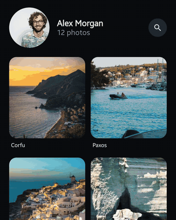

One screen where everything that opens is a shared-element morph, all in one `SharedTransitionLayout`:

- **Photo.** A grid card grows into the full-screen photo and back (a container transform). The corners are paired, so the card's 16 dp and the photo's 0 dp meet halfway instead of a square photo showing through a rounded card. The title and caption follow the photo as it grows.
- **Profile photo.** The avatar zooms into a large circle over a scrim. A pencil button then morphs into a "Change profile photo" dialog, and back into the button.
- **Search.** The search button grows into a bar, and search opens as its own page, cross-fading with the gallery. Recent searches show until the query types in, then the matching photos, which glide into place as each letter narrows them.
- **Collapsing header.** As the grid scrolls, the avatar shrinks into a top bar with a shadow, following the finger.

Taps are serialised by a morph gate: one that arrives mid-morph waits for the morph to land, so an interrupted transition never leaves a stray copy behind. Nothing recomposes while anything morphs or scrolls. The system back gesture closes the topmost layer.

```kotlin
ProfileGallery(
    name = "Alex Morgan",
    portrait = Res.drawable.portrait,
    photos = photos, // List<MorphPhoto>(image, title, caption)
    searchQuery = "xos",
    recentSearches = listOf("Santorini", "Milos", "Hydra"),
    scene = scene, // GalleryScene(photo, avatar, dialog, search)
    onSceneChange = { scene = it },
)
```

The photo morph also ships on its own as `ImageMorph` (`core/presentation/components/imagemorph/`), with `MorphLayers` to switch its fixes on one by one.

## Fogged mirror (`core/presentation/components/fog/`)


> **Try it with your own face.** The clip above is the Bathroom version, but the repo also has a camera version, **Your reflection**. Run the app on an Android phone, open *Fogged mirror → Your reflection*, and wipe the steam to find yourself standing in the bathroom, cut out of your own room on the phone. Leave it, and the steam comes back. Tap **Watch** to see the clip play over your live face.

A steamed-up bathroom mirror, hanging on a tiled wall above the basin, that you wipe clear with a finger. Two versions share one component:

- **Bathroom** (`fog.mirror.bathroom`): a still bathroom behind the glass. It asks for nothing, and mists slowly back over once you stop wiping.
- **Your reflection** (`fog.mirror.camera`): the live front camera behind the glass, so wiping finds your face, standing in the bathroom: on Android, ML Kit's selfie segmentation cuts you out of each frame on the phone itself, and the bathroom shows behind you instead of your own room. Like the bathroom, it mists slowly back over once you stop wiping. One card explains why it needs the camera before asking; without it, the mirror shows the bathroom's still reflection.

What's on the glass:

- **Fog from a real photo.** Condensation texture from a photo of wet glass, over a blurred, milky copy of the scene behind it.
- **Soft wipes.** Soft-edged strokes follow the finger.
- **Mist.** Once you stop wiping, the steamy room slowly fogs the glass evenly back over. (`FogState` can also fill fog back in from the bottom up, like a breath; the demo doesn't use it.)
- **Running drops.** Now and then a drop gathers, in a range of small sizes, and runs down. The bigger it is, the faster it goes. As it runs it stretches from a sphere into a teardrop, and it cuts a clear trail through the fog behind it. Once it stops, it settles softly into the condensation.
- **Drops meeting a wipe.** A drop that runs into a wiped patch slips just inside, then spreads out slowly and thins away into the wet glass.
- **The clip.** Drops run first, then a hand scrubs a porthole clear, smearing away the drop resting in its path. A soft fingertip marks each touch, like a phone's "show taps". One more drop runs into the porthole and spreads away, then the room mists it all back over, so the clip loops. Watch in **Your reflection** plays the same showcase over your live face, ending with the same mist.

```kotlin
val fog = remember { FogState() }                   // starts fully fogged
val drips = remember(fog) { DripDriver(fog) }       // set drips.glass to the glass's size in dp,
                                                    // then drips.advance(seconds) on each frame

FoggedMirror(
    photo = painterResource(Res.drawable.mirror_view), // or the camera's live Painter
    state = fog,
    beads = { drips.beads },                         // read while drawing: a running drop only redraws
)
```

### Made with Compose

Compose made every part of this simple to build, and the same Kotlin runs on Android and iOS:

- **Blend modes are the whole fog.**
  - Inside an offscreen `graphicsLayer` (`CompositingStrategy.Offscreen`), `BlendMode.DstOut` wipes holes in the fog, `Overlay` lays the condensation texture on top, and `DstIn` thins it.
  - Breath and mist *fill back in* rather than pile up: `DstOut`, then `Plus` through a `SrcIn` mask, in `saveLayer` from `drawIntoCanvas`.
  - That's plain Porter–Duff maths, the same on both platforms.
- **`Modifier.blur` and `ColorFilter.colorMatrix`** turn one `Painter` into the misty copy of the scene. The camera is just another `Painter`, so the live mirror needed no special path.
- **Drops are drawn with ordinary draw calls.** Each teardrop is a `Path` of two cubics and an arc, drawn longer the faster it runs. Its shade, rim, edge light and glint are a filled path, strokes, an arc and a circle, and a settled drop gets a soft `Brush.radialGradient` halo. `withTransform` spreads it as it melts into a wipe.
- **Drawing never triggers recomposition.** Beads are handed over as a lambda and read in `drawBehind`. The fog's marks are a `mutableStateListOf` read in the draw phase, and camera frames sit in snapshot state that only `onDraw` reads. So a running drop or a new frame costs a redraw, not a recomposition.
- **Clocks and gestures are coroutines.**
  - `withFrameNanos` drives the drops and the mist.
  - `snapshotFlow` wakes the drip loop the moment you wipe, and otherwise lets the glass sleep.
  - `pointerInput` with `awaitEachGesture` follows each finger across the glass.
  - `repeatOnLifecycle` keeps the camera on only while the screen is showing.
- **Everything is testable.** `runComposeUiTest` plus `captureToImage` read real pixels: a drop is darker in the middle, a spread one is thinner and wider, and a wipe clears the fog. The drips and the mist run on the test's own frame clock, so a test steps through many seconds of drops frame by frame, exactly the same every run.
- **The mirror hangs on a real wall with ordinary layout.** `BoxWithConstraints` measures the screen. An `Image` with `ContentScale.Crop` and a custom `Alignment` crops the wall photo around the mirror. The glass is a `Box` placed with `Modifier.offset` and `size`, and clipped with `RoundedCornerShape`. So the fog lands exactly on the photo's glass on any screen, and a finger on the tiles wipes nothing.
- **A cut-out is just a blend mode.** The camera's frame and the person mask go into one layer, and `BlendMode.DstIn` keeps only you. A small `Painter` then draws the bathroom behind you, and the fog takes the result like any other picture.
- **`expect`/`actual`** keeps the platform code small: CameraX on Android, a stub on iOS. Everything you see is common code.

What makes Compose so good for this is that nothing here needed a custom view, an OpenGL shader or a platform escape hatch. The fog, the water and the wall are ordinary composables, modifiers and draw calls, laid out, animated and tested like any other screen, and one codebase draws them on both platforms. Compose makes a surface that feels physical and alive just another piece of UI.

## Page-turn book (`core/presentation/components/pageturn/`)

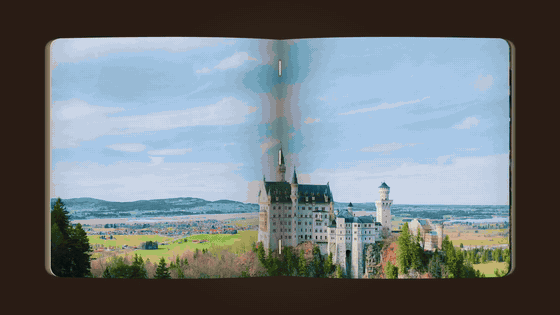

An open book whose pages turn in 3D under your finger, drawn in plain Compose `DrawScope` with no platform canvas, so the same code turns the page on Android and iOS.

- **A leaf of strips.** The turning page is 18 strips hinged end to end. Each one is drawn under its own perspective `Matrix` (the 3×3 projection written into Compose's 4×4 layout), so the page curls instead of flipping as a flat card.
- **The paper stays under your finger.** Take a page anywhere and the spot you took stays under the fingertip as it moves across: each move solves for the turn that puts it there. Seen in perspective, paper lifting off its page first drifts outwards, so the spot is placed as seen from above and then most of the way to the eye's view, and the first move never snaps the page up.
- **Where and how you hold it matters.** The bending lines can lean, fanning out from a point on the spine's line, so one corner peels first and curls tightest. Hold a top or bottom corner and that corner leads; slide your finger along the edge and the hold slides with it, so the lead moves to the other corner. Pull on a slant and the fold lies square to the pull, as paper does. Held near the spine the leaf turns stiff and flat; out at the edge it bends most around your fingers. Let go, and the lean straightens as the page falls, so it lands square.
- **Paper with a spring in it.** In a hand the paper sags back behind the fingers and rolls over calmly when you turn back; flying free, its edge trails in the air. Let go and the bow whips over from one to the other, a flick billows it, and it sways and settles.
- **Let go anywhere.** Past 0.42 of a turn, or on a flick, the page finishes; otherwise it sinks back. Both are critically damped springs, so a page lands without bouncing off the spine, and a page still landing can be caught mid-air.
- **A book of real leaves.** Every sheet is a leaf you can turn: the demo's book is the first sixteen pages of Winsor McCay's *Little Nemo in Slumberland*. The leaves lie in the curve of an open book, rising out of the gutter and cresting, each one under the top page a little flatter, so their edges fan out past it the way an open book's paper does, each showing its own page. As a leaf lifts, the sheets under it rise to take its place; as it lands, the stack it lands on settles under it. A turn starts and ends in that same curve, so no page ever snaps flat.
- **Light and binding.** Each strip shades by how far it faces away, with a sheen while it is up. The gutter darkens under a standing leaf, and the thread it is sewn with shows in its centre fold and only there.

Taps and drags go through one `PageTurnState`, so the demo's scripted drags take the same path as a finger.

```kotlin
val book = rememberPageTurnState(spreadCount = spreads.size)
PageTurnBook(
    spreads = spreads, // List<ImageBitmap?>, one 2:1 image across both pages, or null for blank paper
    state = book,
)
```

## Paper plane (`core/presentation/components/paperplane/`)


A chat that sends each message as a paper plane. Type, and a white paper dart appears on the send button; send, and the letters are drawn into the button one by one, the button swelling a little with each, then the dart itself lifts off, loops up the conversation and comes in low over the message's place, letting each letter go as it passes over it, before it flies off the screen.

- **A dart folded for real.** The plane is a sheet of paper folded into a classic dart: the corners in twice, in half, and the wings opened out into a V. Creased down the middle, paper springs back, so the dart's two halves stand a little apart about its spine. The sheet is cut along every crease into flat facets, each turned about its creases in 3D and drawn under its own perspective `Matrix`. Each rigid part of the dart is a stack of paper, drawn layer by layer as the eye sees it, so the flaps folded over the wings lie on top of them.
- **White paper, shaded by its own folds.** Paper is lit mostly by the room, from every side at once, so it stays white whichever way it turns. How much of the room each side of each facet sees is worked out once, by casting rays out from it past the rest of the dart, so it falls into shade only where its own paper stands over it: in the V between the folds and on the keel under the wings. A little window light turns it a touch brighter towards one side. A faint grain and its fibres are mapped onto every facet, and the dart casts a soft-edged shadow on the conversation that spreads the higher it flies.
- **The icon is the plane.** The send button shows the folded dart itself, seen close up three-quarters from behind, and the plane takes off from exactly that pose and camera, then eases back to its own as it grows. The button grows with each letter it takes in, as far as the field has room for it, and the dart lifts off at that size.
- **A throw, not a tween.** It is thrown hard off the button and slows along the loop, so it comes in over the message at the pace it drops letters at. Its nose follows its climb off the screen and its glide back down, and it banks as a glider does, by its speed and how tight it turns (`tan bank = v²κ / g`), rolling in and out with a lag. It never quite flies steady: it rocks, yaws and drifts a little, at its own pace on each.
- **Letters that fall.** Each letter is let go a little before its place and carried on by the plane, slowed by the air, falling faster as it goes, tumbling out of its spin and growing back to its size. It lands exactly on the text it stands in for, and the bubble grows in behind the letters as they land. However long the message, the last letter lands within 0.6 s of the first.
- **No jump.** The message's place stays shut while its letters go into the button and its plane flies round. It opens as the plane comes down to it, laid out full height at its foot the whole while, so the conversation moves up just in time and the plane flies to where the message will stay.

Planes fly side by side: send again while one is up and the next takes off with its own message.

```kotlin
val planes = rememberPaperPlaneState()
val letters = rememberLetterStream()
// In the send button: the dart a plane lifts off as, grown with the letters it takes in,
// no further than its field has room for.
PaperPlaneIcon(color = paper, modifier = Modifier.size(26.dp).graphicsLayer { scaleX = grow; scaleY = grow })
val most = iconRoom(iconBounds, fieldOutline, inset = 3.dp.toPx(), most = 1.6f)
// The message's place in the list: shut until its plane comes down to it.
Modifier.planeLanding(planes, key)
// On send: the typed letters into the button, then the plane with the landed text's layout.
letters.pour(draftLayout, draftOrigin, into = { button.center }, arrived = {})
planes.launch(key, planeTakeoff(grownIconBounds), landedLayout, at = { landedOrigin })
// Over everything: where the letters and the planes are drawn.
LetterStage(letters, Modifier.fillMaxSize())
PaperPlane(planes, paper = paper, Modifier.fillMaxSize())
```

## Pull cord (`core/presentation/components/pullcord/`)

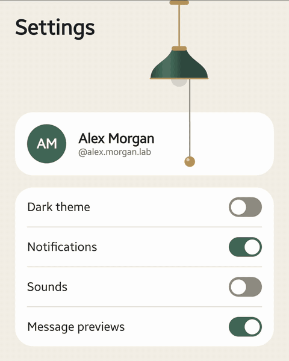

A pendant lamp hangs over a settings screen with a bead on its cord, already swaying as the screen opens, as if the door had let in a breath of air. Pull the bead down and the cord clicks, the lamp comes on and the screen turns dark in its light; pull it again and it goes off. A real pull turns into a UI action.

- **A cord that is a rope.** The cord is a Verlet rope of 12 points, pinned at the shade, falling under gravity and held to its length two dozen times a step. It only pulls, so thrown up it goes slack and crumples. It is stepped at a fixed 120 Hz on `withFrameNanos`, so it moves the same on any screen, a finger's move spread over a frame's steps so a flick keeps its speed at 60 Hz too, and drawn as one smooth `Path` through its points with the bead on the end.
- **Resistance, then a click.** Past its length the cord gives a little, less and less the further it goes, like a spring switch. A finger 48 dp down from where it took the bead clicks it, once a pull however the finger goes on; a tick of haptics goes with it, from Compose's own `LocalHapticFeedback`: a key's click on Android and a light impact on iOS, so no platform code. A sideways tug only swings it.
- **A shade that answers the pull.** The shade is a damped pendulum from the ceiling. The stretched cord pulls on its side, so its rim dips towards the finger, and let go, the stretch comes out at once and throws the bead up past where it hangs; the cord and the shade sway and settle.
- **The new look spreads from the bulb.** Switched, the screen is drawn in both looks, the old one underneath and the new one clipped to a circle that grows from the bulb to the farthest corner, then the old one is let go. The look the lamp is on is always the one on top, so it alone takes touches and is read by a screen reader.
- **Light that adds.** Lit, the lamp throws a cone of warm light down over the screen, a radial gradient in a layer of its own blended with `BlendMode.Plus` and feathered at its edges by a conic mask, and the bulb warms up smoothly as it comes on. The warm-up is the layer's alpha, so it never redraws the cone; switched off, the bulb goes out at once and its light fades with the lit look as the day look covers it.
- **A switch for a screen reader.** The bead is a 48 dp switch, "Lamp cord", that says whether the light is on and switches it with a tap. It stays where the bead hangs at rest, so its focus doesn't chase a swinging cord.

Nothing recomposes while the cord swings or the light spreads: the rope, the shade, the reveal and the warm-up are all read in layout or draw, and only a switch, and the end of its spread, recomposes. The lamp sleeps once it hangs still. Whether it is lit is saved, so it comes back lit after a rotation; `snapTo(lit)` sets it without a switch, its haptics or `onSwitch`. `stir()` sets the cord swaying as a breath of air would, for a lamp that is already alive when its screen opens.

```kotlin
val lamp = rememberPullCordState()

PullCordLamp(
    state = lamp,
    across = 0.62f, // where it hangs, as a share of the width from the left
    onSwitch = { lit -> /* after the click's haptic tick */ },
) { lit ->
    // The screen in one look or the other, over an opaque background; while the new one
    // spreads, both are composed.
    SettingsScreen(if (lit) nightPalette else dayPalette)
}
```

## Magnet filter (`core/presentation/components/magnet/`)

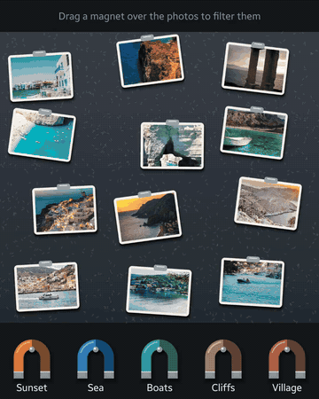

Twelve island photos lie scattered on a steel table dusted with iron filings, with five horseshoe magnets, one for each tag and each in its own colour (Sunset, Sea, Boats, Cliffs, Village), hanging from nails in a rail along its foot. Drag a magnet over the table: the filings rise along its field, matching photos are pulled towards it, harder the better they match, and the strong matches snap and stick. What sticks is the filter's result. A real sweep of a magnet turns into filtering search results.

- **A graded pull with a clear threshold.** Each photo has a hand-tuned strength for each tag. A magnet pulls it with `strength × pull / (distance² + softening)` within its reach, so a match snaps close up, and a photo sticks only if it matches at least 0.5 and touches the magnet, or the cards already on it, as pins chain. Only a photo that will stick is drawn in: a weaker match stays where it lies, so whatever moves towards a magnet is counted, and the result stays exact. A magnet is a search, so it finds every match on the table: one out of every magnet's reach is let off its spring and slides across to the nearest magnet that will hold it, under any other cluster in its way, and the count is always the whole result. Stuck cards take places on rings round the magnet, so a cluster settles rather than shuffling for room. Every loose card is tied home by a weak spring, so the leaning settles and everything slides back. A magnet doesn't pull a print it won't hold, but carried into one it nudges it aside where it touches, and the print slides back to where it lay. While a magnet is out every print it isn't holding is shaded, not at all if it is on its way to the magnet and only lightly if it is a weaker match within the magnet's reach, so what was found stands out and what is merely related shows as such.
- **Magnets on nails.** In the rail each horseshoe hangs from a nail by its arch and swings there as a damped pendulum, the same one the pull cord's lamp shade swings on. A magnet flicked home hooks onto its nail and swings from the way it came, the rack sways as the screen opens, and a third magnet tugged at while two are out jiggles on its nail and stays, with a buzz: two at a time is the most.
- **Two magnets: two searches, or one.** Apart, two magnets are two searches side by side, each holding its own; a photo matching both stays with whichever reached it first. Let one go close to the other and it snaps to its side with a click: joined, they are one search, "Sunset + Sea", holding only what matches both under one badge, and what matches just one falls off and slides home. The pair moves as one, and putting either back on its nail leaves the other searching alone.
- **The cluster is the result.** A badge over each magnet, ringed in its colour, counts what is on it, "4 photos". Tap a magnet to fan its photos out into a grid under a header, "Sunset · 4 photos", each with its title; tap a photo there to open it, grown out of its card into the whole picture with its caption, and tap anywhere to close it, and again to fold the grid back. System back does the same, one layer at a time, before it leaves the screen. Pull a photo off by hand to drop it from the results. Flick a magnet back into the strip and its photos fall off and slide home, and the magnet lands in its slot.
- **Haptics that say how well it matched.** A strong match snaps with a crisp click, one that only just matches with a light tick, and a magnet landing back in its slot closes the gesture with a soft one.
- **Filings that follow the field.** 1,600 short strokes turn to the summed field of the magnets where they lie and rise where it is strong; once the magnets are away they settle back as they fell. They are drawn as raw line points, one batch for each of four brightnesses, from arrays made once, traced again only when a magnet moves, in a layer of their own. A stroked path of that many contours cost a whole frame on a phone; raw lines with square ends cost a few milliseconds.
- **For a screen reader.** Every photo is a node with its title and the magnet it is on, found on its card in the grid, where it opens. Every magnet is a switch, "Sunset filter, 4 photos", with Apply and Remove actions that put it down in the middle of the table or back in the strip. The count is announced politely as it changes.

The physics is a plain state holder stepped at a fixed 120 Hz, like the pull cord's. Cards and magnets are drawn in one layer and read only while drawing, and their screen-reader nodes are placed in layout, so nothing recomposes while they move: only a photo sticking or coming off, a magnet going out or back, or the grid or a photo opening, recomposes. A change of count is announced from a node that stays still, so a sliding magnet isn't read out again at every step. The frame loop sleeps once everything is still. It is demo state: a table made again starts with every magnet in the strip.

```kotlin
val table = rememberMagnetState(
    photos = listOf(MagnetPhoto("milos", Res.drawable.photo_milos, "Milos", mapOf("cliffs" to 1f, "sea" to 0.9f))),
    tags = listOf(MagnetTag("cliffs", "Cliffs", LabTheme.colors.tagCliffs), MagnetTag("sea", "Sea", LabTheme.colors.tagSea)),
)

MagnetTable(table, Modifier.fillMaxSize())

// The filter's results, by tag: they change only when a photo sticks or comes off.
val cliffs: Set<String> = table.results["cliffs"].orEmpty()
```

## Fishing refresh (`core/presentation/components/fishing/`)

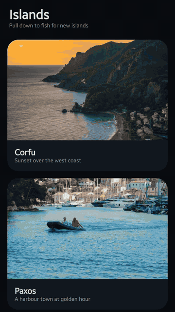

Pull-to-refresh doesn't have to be a boring spinner going round while you wait. Here refreshing is fishing, and the wait is part of the fun. Pull a list down from its top and a rod bends over it, its line tightening, more the further you pull, with a tick of haptics at the threshold. Let go past it and the line is cast: a bobber flies out in an arc and lands in a band of water over the top of the list with a splash, and floats there, bobbing and sending out ripples, for as long as the refresh takes. Then the outcome plays out on the water:

- **A catch.** The bobber is pulled under with a jolt of haptics and the list darkens into the deep. Down there, small and faint on the line, hang the new cards, one under another; the reel hauls them up, growing and clearing as they come, until they reach their places at the top of the list just as it moves down to make room, and the sea clears.
- **Nothing new.** The line is reeled in to an empty hook.
- **A failure.** The line snaps: its slack falls from the rod, the bobber drifts off and fades, and the rod springs up. Pulling again retries.

Then the water closes and everything comes to rest, and the frame loop sleeps.

- **Material's gesture, its own drawing.** The pull is Material 3's `Modifier.pullToRefresh` and `PullToRefreshState`, so nested scroll, overscroll and flings are the library's; the component reads `distanceFraction` and draws only the band. While an outcome plays out, a new pull isn't taken.
- **A real line on real water.** The line is a Verlet rope, the same one the pull cord's cord is made of, now shared in `physics/`: pinned at the rod's tip, held at the bobber, paid out as it flies and wound back as it is reeled in. The water is a height field of 48 spring-coupled columns, a wave equation stepped at a fixed 120 Hz, disturbed by the splash, each bob and the bite. Both live in plain arrays, and the band is drawn with reused paths and strokes, so stepping and drawing it allocate nothing.
- **However long the wait.** The bobber bobs on the water's swell at its own pace, so a wait of a moment and a wait of ten seconds both look like fishing. However quickly a refresh lands, the bobber floats at least 0.6 s first, so a fast answer never skips the bite.
- **The loading is the caller's.** The component knows nothing about loading. The caller hoists a sealed `FishingStatus`, `Idle`, `Refreshing` or `Landed(outcome)`, from a ViewModel, with a new `Landed` for each refresh, and each plays once, so the same outcome twice in a row plays twice. Nothing the caller says is lost: a refresh answered within a frame still casts and plays, and one started while the last still plays out is cast as soon as it has. A `Caught` must catch at least one item, and a `Failed` carries its cause for the caller to log.
- **The catch comes up the line.** `Modifier.risingFromWater` on the list's items records each caught card into a `GraphicsLayer`, so the fishing refresh can draw it hauled up from the deep on the line while its place in the list opens under it, read in layout. Once it is in, it is the list's own item again.
- **For a screen reader.** A Refresh button only a screen reader sees, at the top where the pull starts, refreshes without the gesture, and each outcome is announced politely, every time: "2 new items", "Nothing new" or "Couldn’t refresh".

Nothing recomposes while the line, the water or a hauled card moves: the band is drawn in a layer of its own over the list, the list moves down in a layer of its own, and the rise is read while laying out. Only a refresh starting, its outcome landing and the band closing recompose, and the composition probe in its tests holds it to that. Nothing is saved: the status that says where a refresh stands is the caller's, so a screen made again mid-refresh floats the bobber at once instead of casting again, and an outcome that has already landed isn't played twice.

The demo, `feed.fishing`, is an island photo feed whose source is scripted for the clip: the first refresh catches two islands, the second finds nothing new, the third fails and the line snaps, and the fourth catches one more. Its scripted fingertip pulls through the same nested scroll a finger's drag sends from the top of a list.

```kotlin
// In the ViewModel: Idle, then Refreshing on a pull, then a new Landed with how it came out.
var items: List<Item> by mutableStateOf(emptyList())
var status: FishingStatus by mutableStateOf(FishingStatus.Idle)

fun refresh() = viewModelScope.launch {
    status = FishingStatus.Refreshing
    val outcome = try {
        val new = repository.fetchNew()
        items = new + items // the catch goes on top as it lands
        if (new.isEmpty()) FishingOutcome.NothingNew else FishingOutcome.Caught(new.size)
    } catch (e: CancellationException) {
        throw e
    } catch (e: Exception) {
        FishingOutcome.Failed(e)
    }
    status = FishingStatus.Landed(outcome)
}

// On screen: keep the list at its top as a catch comes in, so it rises into view.
val fishing = rememberFishingRefreshState()
val listState = rememberLazyListState()
LaunchedEffect(viewModel.status) {
    if ((viewModel.status as? FishingStatus.Landed)?.outcome is FishingOutcome.Caught) {
        listState.requestScrollToItem(0)
    }
}
FishingRefresh(status = viewModel.status, onRefresh = viewModel::refresh, state = fishing) {
    LazyColumn(state = listState) {
        itemsIndexed(viewModel.items, key = { _, it -> it.id }) { index, item ->
            Card(item, Modifier.risingFromWater(fishing, index))
        }
    }
}
```

## Pop-up book (`core/presentation/components/popup/`)

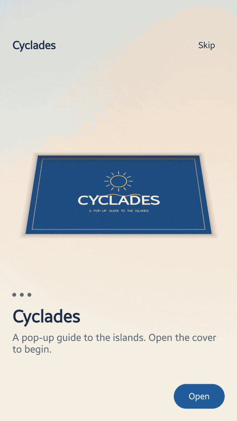

An onboarding that is a pop-up book lying open on the table. Drag the cover open, or tap Open, and paper scenery stands up out of the gutter: a whitewashed chapel with a blue dome on its hills, a wall of bougainvillea. Turn the page and a lighthouse rises over the sea; pull the paper tab at the page's edge and a boat sails out across the waves. On the last spread, pull the tab and a windmill's sails spin, then coast down. Shut a spread and everything folds flat again, face down between the pages.

- **Every sheet is flat, so one projection draws it exactly.** Leaves and pieces are planes. Each one's pose in the book, seen through one pitched camera, gives a 3×3 projection, written into Compose's 4×4 `Matrix`; the sheet's bitmap is drawn under it. The projection is the page-turn book's, moved into a shared `perspective/Homography` that both books use.
- **Pieces stand on the bisector.** A piece's foot is a line on its page, and the piece leans along the bisector of its spread's two pages. So it stands upright with the spread open flat and lies flat when it shuts, the way a V-fold in paper does, and nothing has to be animated by hand: the leaves' angles move everything.
- **Drawn in the right order, without fudge.** Leaves and spreads all turn about the gutter, so they are drawn by how far they point from the eye. The spread the eye looks into goes last; a spread being shut is drawn behind the page shutting it, which covers it as it comes over. A spread's pieces are parallel sheets, so they are layered by how far each lies towards the eye along the way they face, which holds at every angle of a turn.
- **Light and shadow.** Each sheet is shaded by how it faces one light, with a colour filter so the shade follows a piece's cut-out shape. Seen from behind, a folded piece is plain white card with its print faintly showing through. Each piece casts a soft shadow onto its spread as it opens: its silhouette, softened once when the art is painted, then cast along the light onto the page plane by one more projection and clipped to the paper. Every page casts its own shadow onto the table the same way, so the book's shadow follows its pages as they turn. No platform blur is used.
- **Turned as a hand turns a page.** A turn takes about 0.9 s: the page lifts gently off its stack, swings over and eases down onto the other, followed by a stiff spring stepped at a fixed 120 Hz. A page let go after a drag keeps the finger's way and eases down, and a flick that reaches a stack bounces a little. Leaves never pass through each other, and the book always comes to rest, even if Next or Back is pressed while a page is held. Let go past halfway, or with a flick, and a leaf finishes; a tap on the near half turns forward and on the far half turns back. A tab springs back in when let go; the sails take only the outward pull and coast down.
- **Art drawn in Kotlin.** The demo's Cyclades art is vector paths, gradients and printed text, painted into bitmaps once per size, at about the size it is seen. The component takes a `Painter` for the cover, each page and each piece, so a caller can pass images instead. The book fits its frame both ways, so it never spills out of a short one.

Nothing recomposes while the book moves: the leaf angles, tabs and sails are read only while drawing, and the frame loop sleeps once everything is still (while a spread with a bobbing boat is open, it keeps the boat bobbing). The book is decoration to a screen reader; the demo's caption and its Back and Next buttons carry the tour.

The demo, `tour.popup`, is a tall onboarding screen: the book, progress dots, a caption, and Back and Next, side by side in landscape. Each spread has its own sky, from dawn on the cover to sunset at the windmill, fading with the page as it turns, and the caption dissolves into the next. Its script drags the cover open, drags a page over, sails the boat, taps to the windmill, spins its sails twice and shuts the book.

```kotlin
// Remember the spreads: a new list each time would paint the book's art again.
val spreads = remember {
    listOf(
        PopUpSpread(
            near = islandsPage, // drawn with the gutter along its top edge
            far = skyPage,      // drawn with the gutter along its bottom edge
            pieces = listOf(
                // Book units: a page is 300 wide and 190 deep, x from the middle.
                PopUpPiece(chapel, PopUpSide.Near, fromGutter = 0f, x = -112f, width = 130f, height = 150f),
            ),
        ),
        PopUpSpread(
            near = seaPage,
            far = cloudsPage,
            pieces = listOf(
                PopUpPiece(boat, PopUpSide.Near, fromGutter = 74f, x = -122f, width = 90f, height = 74f,
                    motion = PieceMotion.RidesTab(from = -122f, to = 28f, bob = 1.6f)),
            ),
            tab = PullTab(),
        ),
    )
}
val book = rememberPopUpBookState(spreadCount = spreads.size)

PopUpBook(
    cover = coverPainter,
    spreads = spreads,
    state = book,
    description = "A pop-up book of the Cyclades",
)
// Next and Back buttons call book.next() and book.previous(); book.spread says where it is.
```

## Typewriter composer (`core/presentation/components/typewriter/`)

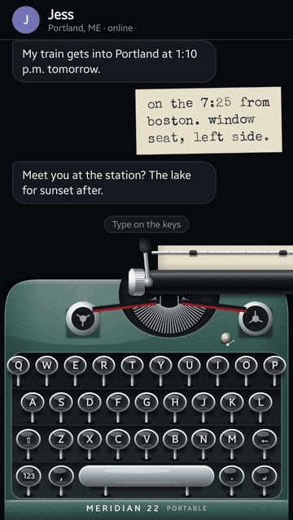

A chat composer that is a typewriter, typed on its own keys. Round, chrome-rimmed keys with celluloid tops sit in the machine's enamel body where the phone's keyboard would be, and every key strikes the sheet in the roller: the key dips on its lever, a type bar flies up from the basket, the ribbon lifts, the letter lands a moment later and the carriage steps on. Five letters before the margin the bell rings; at the margin, or at the next space once the bell has rung, the lever swings and the carriage returns by itself, banging into its stop. Delete runs the carriage back while the correction tape lifts the letter off the paper. To send, pull the sheet up out of the roller: it gives like a rubber band and the ratchet clicks under your finger. Let go too early and it slides back in; past the threshold, or flung, it zips out, trims down to its text and flies into the thread as a slip of paper. Replies come back as plain bubbles.

- **A machine, not a picture of one.** It is a 1950s portable seen a little from above: a low, rounded enamel shell, wider at the front, with a fine orange-peel grain and a soft studio light across it, sitting in its own shadow. The keys stand in a well, a tier higher for each row towards the back, each a celluloid top in a thin chrome ring on a chrome stem that goes down into its slot, and a pressed key sinks along its stem. Behind them, through an opening in the deck, the type bars lie in a fan, and the struck one swings up to the printing point and falls back; the ribbon runs from a spool on either side through the vibrator, which lifts it to the line. The carriage carries a rubber platen with chrome knobs, knurled and turning with the paper, and a paper bail with its scale and rollers; it slides the sheet a letter at a time and slams home on a return. A brass bell's hammer taps it at the margin, and every strike gives the whole machine a tiny shudder. The parts that never move are drawn once into a layer of their own; only the moving ones are drawn each frame.
- **A lever to push.** The chrome carriage-return lever on the carriage's left is a real gesture: take it (anywhere within a thumb's width of its arm and knob) and push it right. It turns about its pivot with the finger; a third of the way over, the line-space pawl catches with a click and the paper feeds a line, and pushed on, the lever drags the carriage home. Let go past the threshold, or flick it, and the carriage is let go to bang home with the return's sound, on a new line; let go short and the lever springs back and the line is taken back. On an empty line it feeds a blank one, and on a full sheet it jams. While a finger has the lever, the keys type nothing and the sheet is not sent, so a short push only ever takes back its own line. The band the lever swings in is kept from Android's back swipe, as at the end of a long line the lever stands at the screen's edge; the printing point sits a little right of the middle so it stays in reach. A screen reader finds the lever with a New line action, and the New line key still swings it by itself.
- **Its own keyboard, never the phone's.** The keys are QWERTY with Shift (for one letter), Delete, New line, a space bar and a page of figures and stops (`. , ? ! ' - :` and more), ten across at up to 48 dp apart, so each is a thumb's width on a phone, and given the room each row is a 48 dp target. A phone on its side puts the thread and the machine side by side, and on a stage that short the machine and its keys shrink together to fit, the keys no closer than 28 dp; the front lip runs down into the screen's foot, and on the shortest stages, as with a large font, the hint over the paper is left out. As lines feed there, the paper rises out of sight under the composer's top rather than over the screen above it. A key strikes as it goes down, and holding one types it once; only Delete goes on, slowly. There is no text field to focus, so the phone's keyboard never opens. A hardware keyboard types too, through the composer's own key events, and Ctrl or ⌘ and Return sends. The text is kept in a `TextFieldState` only the keys edit; the state's `text` reads it and `clear()` lifts it all off. The machine works out what changed: what is added strikes, what is gone is lifted off by the tape. Begun with text, the state keeps only what its keys and its sheet can take. A key that would type off a full sheet is refused, the carriage knocks and the hint says so.
- **The sheet is a pure layout.** `layOutSheet(text)` lays the text out as the machine types it: 18 letters to a line, a new line at New line or the margin, and at a space once the bell has rung, so words are kept whole where they can be; a space just after a return is taken up by it, and Delete takes it off with the letter before it. Four lines fill a sheet; on the last line a space past the bell is only a space, so the sheet is full only at the margin. The same function gives the slip its lines, so it reads exactly as it was typed.
- **Every letter is struck, not set.** Each letter is drawn a little off its place, a little turned and a little faint, seeded by its line, column and character, so the sheet, a recomposition and the slip in the thread all show it the same. The face is Special Elite, and each letter is drawn once into a small picture of its own and copied from there, so a frame of the machine shapes no text.
- **A carriage on springs, in time with its sound.** The carriage is a spring stepped at a fixed 120 Hz: a stiff one with a little overshoot as the escapement steps it on, and, sent home, a loose one that aims past the stop and bangs into it. The return's sound is a zip of clicks and a bang 0.41 s in, so the lever is held over for as long as it takes for the carriage, let go, to bang home at that moment, however far it has to travel.
- **Pull to send.** The pull is a rubber band that stiffens as the paper comes out, and a blank sheet barely moves. Let go past 62 units, or flung faster than 700 units a second once it has started to come out, it is sent; otherwise it springs back. Either way the paper goes on from the speed it was let go at: short, a critically damped spring settles it back into the roller without a bounce; sent, it zips on out speeding up, and its flight into the thread sets off at the speed it came free at, drawn into its place by another such spring. The ratchet clicks each 7 units the paper moves, as a line feeds or the sheet is pulled.
- **Touch for everyone, sound in the lab.** A light tick of haptics goes with each strike, a firmer one with the bell and the carriage's bang, and the ratchet ticks under a pulling finger. The sounds, three strikes chosen by key, the bell, the carriage return, the tape, the ratchet and the sheet coming free, are the lab's own synthesized clips, played through its internal `SoundPlayer`, so they come with an internal overload of the composer, not its public one. Neither sound nor haptics play while the screen is in the background.
- **For a screen reader.** Every key is a button named for what it types ("q", or "Q" after Shift, "Space", "Delete", "New line"), so the machine can be typed key by key; the keys are disabled while the composer is. The machine is "Typewriter", with what is on the sheet as its state and a Send action, so nobody needs the pull; Send and the lever's New line are not offered while the composer is disabled. Once the typing pauses, it hears what was typed or deleted, or that the sheet is full, never the whole sheet again, and the same words twice in a row are heard twice. Each slip is read as its text, and new messages are announced politely.

Nothing recomposes as the machine moves: the carriage, the paper, the bars, the ribbon and the lever are read only while drawing, the paper's feed only in layout, and each letter's strike is worked out once, as it is laid out. A change of the hint's wording, the keys' page or Shift recomposes only those. The frame loop sleeps once the machine is still, and a key's dip is its own small animation. What is typed is saved, with Shift and the page of figures, so it outlives the screen being made again, as when a hardware keyboard is plugged in or the phone turns, and comes back without a sound.

The demo, `typewriter.composer`, is a chat with Jess in Portland, Maine. Its scripted fingertip taps out, on the machine's keys, a message that rings the bell, pushes the lever over for a new line and finishes it, tugs the sheet too little so it slides back, pulls it out, then a second that returns the carriage by itself at the bell, with a typo that the tape takes off and a question mark from the figures, and takes both back once Jess has answered. Its typing waits on frames, so behind another app it stops, and picks up where it was.

```kotlin
val machine = rememberTypewriterState() // what is typed is saved
val flights = remember { SlipFlights() }
val atlas = rememberGlyphAtlas(machine.unit) // the type, shared by the machine and the slips
val slips = remember { mutableStateListOf<Slip>() }

Column {
    LazyColumn(Modifier.weight(1f), reverseLayout = true) {
        items(slips.asReversed(), key = { it.id }) { slip ->
            // Its place shows nothing until its sheet has flown in.
            PaperSlip(slip.lines, slip.tilt, atlas, machine.unit, Modifier.slipLanding(flights, slip.id))
        }
    }
    TypewriterComposer(
        machine,
        onSend = { sheet ->
            val id = nextId++
            // The flight first, undispatched, so the slip's place is never seen empty.
            scope.launch(start = CoroutineStart.UNDISPATCHED) { flights.fly(id, sheet, slipTilt(id)) }
            slips += Slip(id, sheet.lines, slipTilt(id))
        },
        badge = "MERIDIAN 22",
        model = "PORTABLE",
        insets = WindowInsets.navigationBars, // its body, keys and all, runs down behind the bar
        atlas = atlas,
    )
}
SlipFlightStage(flights, atlas, machine.unit) // over both: where the sheets fly
```

## Smoke delete (`core/presentation/components/smoke/`)

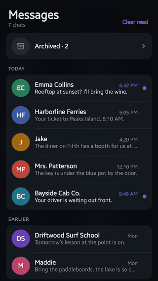

Deleting a chat doesn't slide it away. Swipe it to the left and it burns in from its right edge, the burning edge right under your finger, along a ragged, flickering edge of char, ember and a white-hot core, and the row turns to fine smoke that curls up over the list, still carrying the shapes of its words and its avatar for a moment. Change your mind mid-swipe and draw the finger back: the smoke flows back down into the row behind it, like a film run backwards, and the row comes back column by column as its smoke lands; go forward again and it burns again from wherever its smoke is. Let go before a third of it has burnt (or fling it back) and the rest of the smoke is drawn back in the same way, and the row is whole again; past that, or flung, it burns the rest of the way while the list closes underneath. Swipe to the right and the row goes in mist instead, cooler, low and drifting aside, to the archive. Undo breathes the smoke back into its row. The sides are the layout's start and end, so in a right-to-left layout they mirror: a swipe to the right deletes.

- **Every pixel becomes a particle.** As a swipe starts, the row's drawing, recorded into a `GraphicsLayer` on every draw, is taken as a bitmap (`toImageBitmap`) and cut into about 2,600 particles in the background: the ink at its own colour, and a sparse sample of the card's own colour, which blooms into haze. The row's colours are cut down to a few, so particles can be drawn a colour at a time. While many rows are in the air, a new one is cut into fewer, so the total stays near 11,000.
- **A path is a pure function of where it started and how old it is.** Nothing is simulated from frame to frame. A particle's place is three steps through a fixed curl-noise field (gradient noise with its derivatives worked out alongside, so a curl costs one look-up), plus buoyancy, a kick off the burning edge, and a wander that grows with age, so a solid shape breaks up into wisps. The same particle at the same age is always in the same place, so any frame, forwards or back, can be drawn.
- **The front is 64 column ages.** The row is 64 columns across, and each has an age, how long its particles have been smoke: a straight line in time from the moment it last turned, rising a second a second while the front is past it, and wound back to nothing, at least 2.5 times as fast as it rose and within 0.45 s however old it was, once the finger draws the front back off it. So a frame can be drawn for any moment, a column burnt again carries on from where its smoke is, and scrubbing back and forth for as long as you like keeps three numbers a column and is the same every time. A fast front turns its columns one after another within the frame. The row is cut at the front, but where the front has gone back it comes back only as each column's smoke lands. A finger that takes hold inside the row, rather than at its edge, has the front catch up with it over the first half of that distance again, and from then on the front is right under it. Each column is stamped too with where the row was and what of it showed in the list, so a row the list moves or scrolls mid-burn keeps its smoke, and a row half under the header doesn't smoke over it. Undo runs every particle's age back to nothing, from where it is if it is still in the air, or from half its life if it had faded, so the smoke retraces its own path into the row as visible wisps; it is eased over to where the row is now, at its size now, if the list has moved or the screen turned meanwhile.
- **Batched points in blurred layers.** Each frame's particles are worked out off the main thread by one long-lived worker, in one job for every plume, into a spare set of batches, one for each colour at each of 14 bands of age, and swapped in when ready. The batches grow as they need to, and shrink only once far too big, and the points past a batch's count are parked just off the screen, so filling and drawing them allocates next to nothing. Each batch is one call of round points (`drawPoints` with a count on Android; on iOS, where Skia takes the whole array, the unused points sit just off the screen and a batch gives back room it has far too much of) whose size, colour and opacity are those of its age: ember, then the row's own colour, then smoke. A particle that has spread is drawn twice, a little apart, and half of them a size smaller and half a size larger in the blurred layers, so the body of the smoke reads as a soft mass rather than a few thousand dots; a band of age that straddles the move to the next layer is drawn in both, each in its share, so particles cross over softly. Four layers stack over the list: a haze blurred by 7 dp, a body by 2.5 dp, the crisp young particles, and the glow of the embers and sparks, added to the screen in the dark theme.
- **The row is cut, then closes.** The row draws its recorded layer clipped along the front's ragged polygon. Once it is all smoke, its height springs to nothing, read in layout, and the list closes under the plume, which stays where it was.
- **Feel.** A burn loop whose volume follows how fast the rows are burning, a whoosh for the mist and an inhale for Undo. Sound comes through the lab's internal `SoundPlayer` hook (`rememberSmokeState(sound)`, which the demo uses); the public `rememberSmokeState()` is silent. The loop stops when the app goes to the background. The loop all but falls silent while the finger draws the front back. A tick of haptics as a swipe burns past a third, and again as it comes back short of it (a little short, so a finger hovering there doesn't buzz), and a soft click when the finger lets go there and the row commits; a burn from a key or an action has none.
- **Keyboard and screen readers.** Delete or Backspace burns the focused row, once however long it is held, focus moving on to the next (or the one before, at the end). Each row has its swipe actions as custom actions by their labels (Delete, Archive, Restore).

Nothing recomposes while the smoke moves: the rows read their front in drawing and their height in layout, the overlay draws the particles, and the frame loop sleeps once the last smoke has gone. Smoke is kept for Undo, out of the frame loop, until the caller lets it go with `forget`; what is still in the air then drifts on until it has faded. A scripted finger swipes through the same public `dragStart`, `dragTo` and `release` a finger's drag uses, and `boundsOf` says where a row is.

The demo, `smoke.delete`, is a chat list of friends, a host and the businesses of a summer weekend. Swipe left to delete, right to archive; the "Archived · N" row on top opens the archive, where a right swipe restores a chat. Clear read burns every read chat in a wave. A snackbar, dark on both themes, says what happened for five seconds (longer if the person has asked for more time), politely to a screen reader too, and offers Undo, for an archive as for a delete. Clear read can't be tapped again while its wave burns, and a chat deleted during the wave joins it, so the one Undo brings everything back. Its script burns a chat and undoes it, swipes one too short to commit, archives one in mist and undoes it, clears the read chats and brings them all back.

```kotlin
val smoke = rememberSmokeState()
SmokeOverlay(smoke, Modifier.fillMaxSize()) {
    Column(Modifier.verticalScroll(rememberScrollState())) {
        for (chat in chats) {
            key(chat.id) {
                SmokeRow(
                    smoke,
                    key = chat.id,
                    present = chat.id in inbox, // false: the row closes; true again: it opens
                    start = SmokeAction("Delete", SmokeMaterial.Smoke) { viewModel.delete(chat.id) },
                    end = SmokeAction("Archive", SmokeMaterial.Mist) { viewModel.archive(chat.id) },
                ) {
                    ChatRow(chat)
                }
            }
        }
    }
}
// Undo: put the chat back, then breathe its smoke back in; once Undo has gone, let it go.
viewModel.undo(); smoke.reform(chatId)
smoke.forget(chatId)
```

## Snow globe (`core/presentation/components/snowglobe/`)

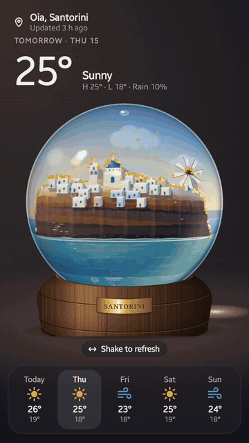

A weather screen whose forecast lives in a snow globe. Shake the globe and the gold glitter swirls up through the water, the forecast refreshes while it settles, and each day's weather shows inside the glass over Oia's caldera: sun with glints and whitecaps, a shower with rain and a rainbow, the meltemi with windmill sails turning. A new day's scene fades in over the last.

- **Real glass.** One refraction shader, run as AGSL on Android 13 and up and as SkSL on iOS, bends the scene through the dome and gives it a window's reflection, a fresnel rim, a caustic and an air bubble. Where the shader can't run, the glass is drawn instead.
- **On a walnut base.** The globe stands on a turned walnut base with a brass plaque engraved SANTORINI. The room is lit by the globe, which throws its shadow and its caustic onto the table.
- **Shaken three ways.** Drag the glass sideways and it swings on a rubber band; shake the phone (the linear accelerometer on Android, Core Motion on iOS, with the jostle of walking with it in a pocket ignored); or press Enter or Space. A shake calls `onShaken` once, and the settle is held for as long as a refresh is pending.
- **Glitter as water moves it.** The water lags the glass, so a shove sends it the other way through the middle and back round the top and bottom, and each turn of a shake sheds a pair of eddies. Each flake wanders on its own. Heavier flakes lag the water, are thrown further against a shove and sink faster, so the finest land last, on the roofs, the dome or the sea.
- **Feel.** A synthesized swish of water behind glass for the shake and a music-box phrase for the settled forecast, through the lab's internal `SoundPlayer`.
- **Reduced motion.** The glass stays still and the water never clouds, and Enter still refreshes.

Nothing recomposes while the globe swirls, and the frame loop and the shake sensor stop while the app is in the background. On iOS the scenes, the base and the sprites are drawn from their own pixels instead of being copied on every draw. The scene is painted with the shared `canvas2d` adapter, which the card file uses too.

The demo, `snowglobe.weather`, is Oia, Santorini: today and four days ahead in a day strip whose highlight slides to the day chosen. A fake forecast service's refresh turns tomorrow into a shower, or fails on cue. Its script shakes the globe by dragging it, lets the glitter settle on the new forecast, and taps through the days.

```kotlin
SnowGlobe(
    scene = day.scene, // GlobeScene.Sunny, Windy or Shower: a change crossfades inside the glass
    refreshPending = fetching, // the glitter waits to settle while this is true
    onShaken = { viewModel.refresh() },
    onSettled = { viewModel.showForecast() },
    description = "Snow globe",
    stateDescription = day.conditions,
)
```

## Card file (`core/presentation/components/cardfile/`)

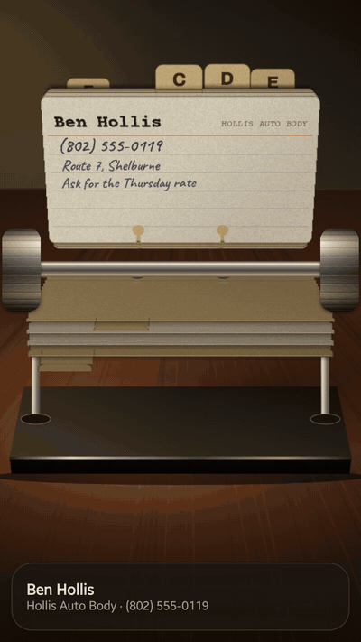

Contacts kept the way a desk kept them in the fifties: cream index cards on a chrome rotary card file, under a warm lamp on a walnut desk at night. Drag the cards and they flip over the top of the wheel; let go and the wheel carries on with the speed of the fling and settles on a whole card, as if it had a detent. Past either end it gives, harder the further it goes, and springs back without swinging past the end card. A divider before each letter stands up a tab; tap a tab, or a card behind the front one, and the wheel spins to it. Tap the front card and it comes up out of its rail and face on, with Call and Message on the sheet under it. Push it back down, tap outside it, press back or Escape, and it is filed into its slot.

- **Painted in one canvas.** The desk, the lamp, the enamel stand, the knurled knobs and every card are painted through the lab's `canvas2d` adapter, shared with the snow globe. The cards are seen from above in perspective strips on the rod, each with its own hit test.
- **Cards baked once.** Each card is grained paper with a red margin and blue rules, the name typed in Courier Prime and the details written in Caveat, and the A–Z dividers' tabs step across the top. A card is baked into a bitmap once and drawn from it.
- **A wheel with weight.** A drag moves the wheel under the finger, a card a notch, and each card ticks as it crosses the top. A release springs it to the whole card a fling of that speed would stop on, starting at the fling's speed. The knobs turn with the wheel, and dragging one turns it more slowly, for fine control.
- **A pile that stays whole.** Seven fallen cards lie in front and fifteen behind. Past them, cards lie exactly beneath the last one shown, so nothing pops or fades as the wheel settles, and a buried divider's tab still shows.
- **Pull and file.** A pulled card lifts from the wheel's shading into its own shadow. Pushed down far enough, or flicked down, it files back and lands exactly as the wheel draws it, without a flash. A card's notches stay open however it is drawn.
- **A frosted sheet.** The sheet under the wheel names the front card, crossfading as each one comes round, or a divider and how many cards stand behind its tab. With a card out it offers Call and Message, and lets go of a filed card as the card starts back.
- **Keyboard and screen readers.** The wheel is one focusable node, described by its front card. The arrow keys spin it, Enter pulls the front card and Escape files it, and focus moves to the pulled card once it is out.
- **Reduced motion.** Spins and pulls go straight to where they end.

Nothing recomposes while the wheel turns: composition reads only which card is in front, never the wheel's position. A script spins, pulls and files through the same `CardFileState` a finger drives.

The demo, `cardfile.contacts`, is 23 invented people, alphabetical by first name and starting on Ben Hollis, each with a 555 number, a line and a note in blue ink. Call opens `tel:` and Message `sms:`; where neither can open, a note says so. Its script flips three cards slowly, flicks on to Maya Brooks, pulls her card out, files it back and returns to the first card.

```kotlin
val file = rememberCardFileState()
CardFile(
    cards = deck.cards, // FileCard.Divider('A'), FileCard.Entry("abby-carter", 'A'), …
    paper = { entry ->
        val c = deck.contact(entry)
        PaperCard.Contact(c.name, c.kind, listOf(c.number, c.line, c.note), c.seed)
    },
    describe = { card -> describe(card) },
    state = file,
)
```

## Bookshelf (`core/presentation/components/bookshelf/`)

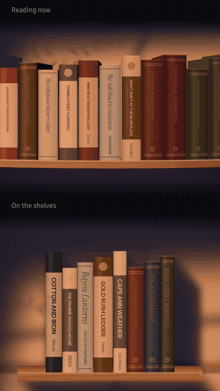

A reading list kept on shelves in the light of a window. The books being read stand on a ring that runs off both sides of the screen: drag it and it spins, past the books you can see, and settles with a book square in front. Below, two oak planks hold the books to read next and the books already read. Pull a book down by the top of its spine and it tips forward, slides out, turns its cover to you and opens; one being read opens at its ribbon, a new one at its title page. Its pages turn under the finger. Push it down and it goes down and tips back under the finger; from its first page, drag right and its cover closes with the finger. Let go far or fast enough, or press back, and it goes back to its place; a short drag lets it settle open again.

- **Books in perspective.** Each book is a box of six faces, posed in 3D and projected through one camera: spine, covers, head and fore edge, and the pages, each face its own bitmap mapped onto its quad exactly, lit by where it faces. Books further round the ring turn along its curve and dim.
- **Window light.** The wall, the ring's plank and the oak planks stand in a light baked once at a quarter of the screen's resolution: sun through a window, the shadows of an olive branch swaying gently across it, a shadow behind each book. By day the light is warm and white; in the dark theme, a dusk.
- **Spines baked once.** Cloth bindings in dark colours with gilt titles in Instrument Serif, or paper ones lettered in Instrument Sans, each chosen and coloured from the book itself, so the same book always looks the same. Covers are drawn too: a gilt emblem on cloth, a band and a disc on paper.
- **Typeset pages.** A chapter is set in Instrument Serif, justified, each paragraph after the first indented, and broken into pages that each show what fits. The page's texture is baked from the same setting that counts its lines.
- **Paper that follows the hand.** A page turns from wherever it is taken: the held point stays under the finger, a corner pulled on a slant peels first, the leaf bows and casts a soft shadow on the page under it, and a flick finishes the turn. Several leaves can be in the air at once.
- **A ribbon.** The bookmark is a satin ribbon that lies over its page as a cord with weight, and turns with its leaf.
- **Feel and sound.** Each book that comes to the front of the ring ticks, and a book slides out, opens and has its pages turned with sounds of its own.
- **Screen readers.** Each spine is a button labelled with its title and author, and for a book being read its chapter and the time left in it; the ring has previous and next actions; an open book says its title and page and has Next page, Previous page and Close actions; and taking a book out or putting it back is announced.
- **Reduced motion.** A tipped book settles without bouncing, taking a book out, opening it and putting it back take less than half as long, and the leaves' shadows stop swaying; the ribbon still settles where it lies.

Nothing recomposes while a book is in hand, and the ring recomposes only as a new book comes to the front: the spin and the pose are read in drawing only. Spines, covers, pages and light are baked off the main thread; a chapter is broken into pages as its book opens.

The demo, `bookshelf.reading`, has twenty invented American books being read on the ring, with *The Salt Road to Galveston* in front, and sixteen on the planks. Three of them have a chapter of their own, set in a Galveston cotton exchange, a Vermont farmhouse in the first snow and a Chicago diner at closing time; the other books being read share one.

```kotlin
val shelf = rememberShelfState()
val content = rememberShelfContent(listOf(books), readingBookId = books.first().id)
ReadingShelf(content, shelf, chapterFor = { id -> chapters[id] }, style = ShelfStyle.Ring) { hero ->
    Column { hero(Modifier.fillMaxWidth().height(320.dp)) }
}
```

## Paper bag cart (`core/presentation/components/paperbag/`)

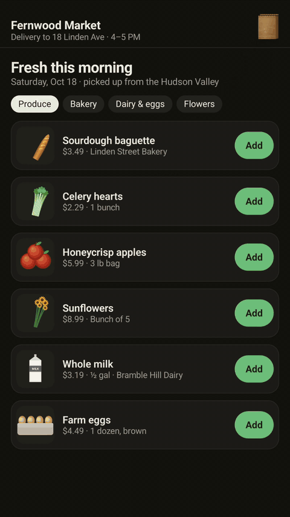

A grocery store's cart icon as a small brown kraft paper bag. Tap Add on a product and it hops out of its row on an arc and drops in. The bag squashes and rocks with the weight, its front bows out as it fills, and its count is rubbed off and written again in grease pencil. Long things poke out of the top: a baguette, celery and a bunch of sunflowers. The short ones still show over the rim: apples, a carton of milk, a tray of eggs. Tap the bag and it grows out of the corner and tips toward you, raising its back rim so you can see inside, over a list of what is in it. Tap − on a line and that thing lifts back out of the bag. Check out and everything sinks into the bag, its top folds over the front as a clerk folds it, and the order is placed; then the bag goes back to the corner empty. Done, Back or Escape sets the bag back in the corner.

- **Painted in one canvas.** The bag, what is in it and everything flying to it are painted in one canvas over the screen, through the lab's `canvas2d` adapter. Nothing is clipped, so what pokes out of the bag shows whole in the bar. Its side gusset and pleat, the toothed rims and a front of tiled paper fibres shaded by how full it is follow the HTML prototype call by call.
- **Grease pencil.** The count is written in Caveat four times over, slightly off, with flecks knocked out where the wax skipped over the paper. Each number is baked once.
- **Weight.** A landing squashes the bag on a stiff spring and rocks it on another. The front bulges by how many things are in it, and opening the bag lifts its contents into view.
- **Things keep their place.** Each thing has its own place across the bag's mouth for as long as it is in, so lifting one out moves nothing else. A row counts what is in the bag or on its way there, beside its unit line, never cut off with it.
- **Feel and sound.** Something landing ticks, and kraft paper sounds go with it, synthesized in layers of tiny creases: a crinkle, a rustle and a thump as a thing drops in, a rising scrape as it lifts out, and a slow bend as the bag tips.
- **Keyboard and screen readers.** The bag is a button that says how many things are in it. Adding and removing are read out, and the open bag is a pane titled Your bag, with the list behind it hidden. Focus rings show only for the keyboard, and focus moves to Done and back to the bag only for the keyboard too.
- **Reduced motion.** Things drop straight in, and the bag opens and closes without the springs or the tip.

The bag's clock runs only while something moves, and its motion is read in drawing only.

The demo, `paperbag.cart`, is Fernwood Market's Saturday aisle of six invented products, with a baguette from the Linden Street Bakery and milk from Bramble Hill Dairy. Its script adds the baguette, the celery, the apples and the sunflowers, opens the bag and lifts the apples back out, closes it, then opens it again and checks out, so the clip loops.

```kotlin
val bag = remember { PaperBagState() }
Canvas(Modifier.fillMaxSize()) {
    bag.frame // redraw as the bag moves
    val g = Canvas2D(drawContext.canvas, size.width.toInt(), size.height.toInt())
    g.setTransform(density, 0f, 0f, density, 0f, 0f)
    drawBag(g, x, y, 34f, bag.pose(items), ink, dark, density)
}
```

## Star stickers (`core/presentation/components/stickers/`)


A star rating that feels like a teacher's sheet of gold foil stars. Under a row of five dashed slots lies a liner sheet of embossed stickers. Drag across the sheet or the row and each star you pass peels off its backing with a curl, flies up in an arc and is pressed into its slot, with a glint across the foil and a little bounce. Drag back and the last stars peel up out of the row and settle on the sheet again. A tap jumps to that score, and the stars flick on in order.

- **Painted in one canvas.** The sheet with its lifted corner, gloss and print, the die-cuts, the slots and every star are painted through the lab's `canvas2d` adapter, ported call for call from the prototype. Each star is ten facets shaded from one light, on a gold ramp, with its embossed ridges, a brushed sheen that follows the light and a glint when it's pressed. The light leans with each star's speed and the finger's place, so the foil catches it as stars move.
- **One number per star.** A star's place from the sheet to its slot drives its peel, flight and press, so a drag can turn back mid-air without a jump. A star moves only once its neighbour is far enough along, which lays a long drag down one star after another and makes a tap's stars flick on in order.
- **A peel you can see.** The peeled flap is the sticker's paper back laid over the fold, shaded as paper bending, with its shadow on the foil. A peeling star lifts up off the sheet, clear of the finger dragging across it.
- **The label keeps up.** The word under the row names the stars that have landed, so it never reads "Loved it!" with one star down.
- **Sounds and touch.** Each peel crackles as its tack lets go, each press lands with a soft thud and a foil crinkle, a star laid back on the sheet pats down, and each press ticks.
- **Keyboard and screen readers.** The rating is one slider, read out as "4 stars, Really good". The arrow keys step it, Home and End go to the ends and the digits 0–5 set it.
- **Reduced motion.** The stars fade in place instead of peeling and flying.

The frame loop runs only while a star is moving or the light is catching up with the finger.

The demo, `stickers.rating`, rates an order from Lupita's Taco Truck in East Austin, with a note and Submit, which thanks you for the score. Its script drags across the sheet to five, back to three, taps the first slot and then the fifth, and drags the row clear again.

```kotlin
val stickers = rememberStarStickerState()
StarStickerRating(
    stickers,
    label = { landed -> words[landed] },
    valueText = { score -> "$score stars" },
    description = "How was everything?",
    labelColor = muted,
    labelSetColor = accent,
)
```

## Mailbox badge (`core/presentation/components/mailbox/`)

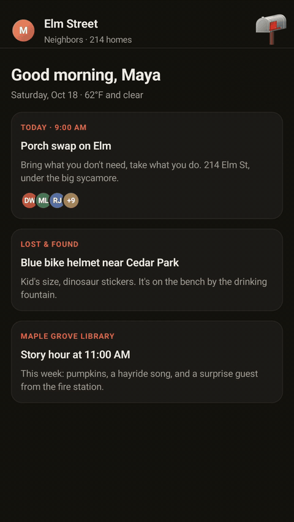

An inbox button in a top bar that is a little tin rural mailbox on its post, seen from the front left. When mail comes, the door cracks open, an envelope slips in and the door claps shut, and the red flag swings up on its spring with the unread count painted on it. More mail while it is up jiggles the flag and bumps the number. Tap the mailbox, or pull down on it past halfway, and the door drops open on the letters inside as the inbox slides in. Read everything and the flag comes down by itself.

- **One canvas.** The galvanized body, its two pressed ribs and the sun's glint along its top, the arched door on its bottom hinge, the dark inside, airmail envelopes and the flag are all drawn in one `Canvas` through the shared `canvas2d` port of the prototype's drawing. The dark theme draws the tin and the post at dusk.
- **A flag that reads at icon size.** The flag pivots low on the box's side. Down, it lies along the side; up, it stands clear of the box, and its plate and number are sized so the count reads at icon size.
- **Springs, not tweens.** The flag rises on a bouncy spring and comes down on a slow, fully damped one. The door swings on a hinge spring with a stop at each end. Everything steps at 240 Hz in simulated time, and the frame loop sleeps once nothing moves.
- **Feel and sound.** Synthesized tin sounds play for the door clapping shut and the flag landing, along with a spring twang, a hinge creak, a paper slip and a tick for the count. A light haptic tick marks the flag going up.
- **Screen readers.** The mailbox is a button labelled "Inbox, 2 unread" (or "no unread messages"), and new mail is announced.
- **Reduced motion.** The flag and the door snap to where they are going, and nothing flies.

The demo, `mailbox.badge`, is an invented neighborhood app for Elm Street: a morning feed of porch swaps and lost helmets, and an inbox of neighbors' mail.

```kotlin
val box = remember { MailboxState() }
Mailbox(box, unread = inbox.unread, letters = inbox.size, contentDescription = label, dark = isDark,
    onClick = { box.open { showInbox() } })
// When a message arrives:
box.deliver { inbox.add(message) }
```

## Padlock (`core/presentation/components/padlock/`)


A sign-up step where the password's strength meter is a solid brass padlock under a warm lamp. An empty or weak password leaves the shackle up and swung half a turn open, standing clear of the body, and each weak keystroke knocks it about in its holes. As the password gets stronger the body fills out, the shackle swings into line, lowers notch by notch and turns from soft brass to hardened steel; at strong it drops home under its own weight with a clunk, a small bounce and a glint across the brass. Erase a few characters and it springs back open. Tap the lock to show the password: the keyhole cover swings aside on its rivet and warm light shows through.

- **Drawn as the prototype draws it.** The lock is ported call by call from its HTML prototype onto the shared `canvas2d` adapter: the shackle is one U path stroked six times, each narrower and nudged toward the light, so it reads as a round bar; brass and steel are two colour ramps blended by one value; the body has a brushed grain baked once from a fixed seed, a debossed maker's stamp and a bevel.
- **Springs and a drop.** Lift, swing, steel, rattle, bounce and the cover are springs aimed by the level, stepped in fixed 1/240 s substeps; locking swings the shackle into line, then lets it fall under gravity and lands it where it hits. The frame loop sleeps once everything is at rest.
- **Feel and sound.** A clunk felt as a confirm where the shackle lands, a tick at each level and as it springs open; synthesized sounds for the clunk, the spring, the rattle and the cover.
- **Screen readers.** The lock is a switch labelled Show password; the level under it is a polite live region, and the rules under the field say what is missing, so the lock is never the only cue.
- **Reduced motion.** Every spring settles at once, and the rattle stops.

The demo, `padlock.password`, is step 2 of signing up for an invented credit union. Its script types `maple42-River!` in the chunks a person types it in, shows the password and hides it, erases three characters so the lock springs open, types them again so it locks, and clears the field.

```kotlin
val lock = remember { PadlockState() }
LaunchedEffect(password) { lock.onText(checkPassword(password).level) }
Padlock(lock, onToggle = { lock.showPassword(it) }, label = "Show password", sounds = sounds)
```

## Pencil cup FAB (`core/presentation/components/pencilcup/`)

A notes app whose floating + button is a little cobalt-glazed pencil cup in the corner of the screen, under a warm lamp. Tap it and the four tools inside leap out one after another and fan up and to the left, each with its label: a pencil for a new note, a highlighter for a checklist, scissors to clip from the web, a loupe to scan a page. Pick one and it flies up and slips into a pocket at the top corner of a new sheet, riding there half out, while the others fall back into the cup, bounce and rattle; type a title (or a first item, or a link) and tap Done, and it joins the list under what you typed as the tool lifts out of its pocket and arcs back into the cup while the sheet slides away under it. Done with nothing typed cancels. While the keyboard is up, the sheet rides on it, frame by frame, with the tool in its pocket. Back, Escape or a tap outside the sheet cancels it: the tool goes home and nothing is added. Or in one move: press the cup, slide up onto a tool and let go.

- **Drawn as the prototype draws it.** The cup and tools are ported call by call from the HTML prototype onto the shared `canvas2d` adapter: the dark inside and back rim first, then the tools, each a few paths in its own frame, then the glazed front wall with its drips, speckles and slip-painted plus, so whatever is below the rim is hidden. The tool on the sheet draws on its own layer above it, clipped at the sheet's top edge so its lower half is tucked behind it, with a soft shade where it goes in.
- **Springs and gravity.** Fanning out is springs toward targets on an arc, staggered 45 ms apart, with the angle lagging so each tool rises before it leans. The cup also slides the sheet on its own clock, so the tool in its pocket rides with it, and on Done throws the tool on a parabola to just above the cup. Dropping back is gravity: each tool bounces off the bottom of the cup, an underdamped angle spring rattles it and the cup rocks; the landing speed sets the clink's volume. Fixed 1/240 s substeps; the frame loop sleeps once everything is at rest.
- **The gesture.** One pointer handler on the cup: a tap toggles, a drag opens the fan and lights the tool nearest the finger, and the release point picks it, so even a fast swipe with few samples picks the right tool.
- **Feel and sound.** A tick as the fan opens and as a drag lights each tool, a confirm on a pick; synthesized lift, pick and clink sounds, each tool's clink a little higher on the glaze.
- **Screen readers and keys.** The cup is a Create new button that expands and collapses; the labels are buttons (Up and Down move between them, Escape and Back close the fan or the sheet), and what happens is announced in a polite live region.
- **Reduced motion.** The tools jump straight to the fan and back, with no clatter.

The demo, `pencilcup.fab`, is Fieldbook, an invented notes app. Its script taps the cup open and shut, presses it and slides onto the pencil to make a new note, types a title, taps Done, and puts the list back as it began.

```kotlin
val cup = remember { PencilCupState() }
PencilCupFab(cup, labels, cupLabel = "Create new", colors, dark, sounds) {
    // Slide the sheet by cup.sheetSlide (0 up, 1.05 below the screen), 64 % of the screen high.
    MySheet(slide = { cup.sheetSlide }, tool = cup.sheetTool, onDone = { cup.done() })
}
```

## Locket avatar (`core/presentation/components/locket/`)

An edit-profile screen where the profile photo lives in a small gold locket hanging on a fine chain under a warm lamp. Outside, only an engraved script initial shows. Tap the catch and the lid springs open on its hinge, swings a little past and settles, showing the photo behind its glass and the inside of the lid engraved with the owner's initials and a date. Drag a photo up from Recent and, as you let go over the locket, it shrinks and trims itself from a rounded square to the oval, with a sweep of light across the glass. Tap the locket, or push the lid across with a finger, and it snaps shut with a glint, and the chain swings. Grab the closed locket to swing it on its chain.

- **Drawn as the prototype draws it.** The locket is ported call by call from its HTML prototype onto the shared `canvas2d` adapter: three ellipses for the rim, the cup and the bezel, and a lid drawn under `scale(cos angle, 1)` about its hinge, so it reads as a 3D turn, with its mirrored inside face past 90°. The four photos are drawn in code from fixed seeds, once.
- **Springs and a pendulum.** The hinge is an underdamped spring opening and a stiff one closing, its overshoot stopped short of the screen's edge; the chain is a damped pendulum whose swing is walled in so the whole locket, lid included, stays on screen. The trim is a superellipse whose exponent goes from 7 to 2. The frame loop sleeps between the catch's glints.
- **A drop that lands.** Only where a photo is let go counts, and the point is turned into the swinging locket's frame, so a quick swipe lands. A photo dropped on the shut locket opens it on the way in; let go anywhere else and it slides back to its slot.
- **Feel and sound.** A tick as it opens and as a photo lands, a confirm on the snap, and synthesized sounds for the catch, the snap, the chime of the glass, the photo lifting and sliding home, and the chain.
- **Screen readers and keys.** The locket is a button, Open or Close locket, with expand and collapse; each Recent photo is a button "Use photo: …", and Enter or Space works them. The photo's name is a polite live region, and the round chip under the locket shows what others see. Escape closes the locket.
- **Reduced motion.** The lid opens and shuts at once, and the chain hangs still.

The demo, `locket.avatar`, edits the profile of a gardener at an invented garden shop. Its script taps the catch, drags a beach photo up into the open locket, taps it shut, and puts the first photo back.

```kotlin
val locket = remember { LocketState() }
val photos = remember { locketPhotos() }
Locket(locket, photos, labels, muted = muted, accent = accent, sounds = sounds)
```

## Birdcage (`core/presentation/components/birdcage/`)

A group chat's notification switch as a little brass birdcage with a canary inside, hanging in the window light. Each new message makes the canary hop on its perch and sing, with notes rising from its beak. To mute the chat, take the rolled hem of the linen cover on top of the cage and pull it down, the way you'd put a bird to bed: let go past halfway, or with a flick, and it falls like weighted linen, faster as it goes, lands softly on the base and its hem ripples once; let go early and it is drawn back up, easing into the top, where the linen gathers for a moment at the crown. Under the cover the canary tucks its head into its shoulder and sleeps, and new messages only stir the cloth while a grey count collects on the Latest row. Push the hem up and it blinks awake and lifts its head smoothly out of its shoulder. A tap on the cage toggles it too.

- **Drawn as the prototype draws it.** The cage is ported call by call from its HTML prototype onto the shared `canvas2d` adapter: dome ribs and rings stroked three times each (a dark edge, the brass and a highlight toward the window), the back half dimmed behind the bird; the cover is one path that follows the dome down to its scalloped hem, filled with a linen weave baked once from a fixed seed, with pleats drawn on their own layer and faded in at their tops, and a rolled hem stroked as a tube.
- **Weighted cloth and a fling.** The hem follows the finger 1:1 past a 6 dp slop, with a little give past either end. On release its speed over the last 100 ms is projected forward to pick down or up, and the cover carries that speed on: gravity speeds it up going down, a steady pull draws it up, and near the end it brakes at the constant rate that stops it exactly there (a = v² / 2d), so it never passes its end and never stops dead. The braking sets off a hem ripple on landing and a gather of the crown's scallops at the top, and the hem swings as it slows. The canary's sleep follows how far down the cover is, so it tucks in only once it's dark.
- **Feel and sound.** A confirm where the cover settles and mutes, a tick as it lifts; synthesized chirps, a cloth settle, a lift, a rustle for a muted message and a swish as the hem is taken.
- **Screen readers.** The cage is a switch labelled Mute this chat that takes focus and Space or Enter; the state under it is a polite live region, so the drawing is never the only cue.
- **Reduced motion.** The cover goes straight to where it is aimed and the hem doesn't sway.

The demo, `birdcage.mute`, is the group info screen of an invented running club in Austin. Its script delivers a message (the canary sings), pulls the cover down, delivers another (it is silenced and counted), pushes the cover back up and delivers a third, then puts the first message back.

```kotlin
val cage = remember { BirdcageState() }
LaunchedEffect(messages) { messages.collect { cage.deliver() } }
Birdcage(cage, label = "Mute this chat", sounds = sounds)
// cage.muted says whether the chat is muted.
```

## Zipper scrollbar (`core/presentation/components/zipper/`)

A contacts list whose fast-scroll thumb is the brass pull of a zipper sewn down its right edge. At the top the list is zipped shut; as you go down it opens behind the pull, the teeth prised apart over a red flannel lining, so you can see how far you've come. Put a finger on the pull and its tab stands up off the tape while a cotton tag swings out with the letter you're on; drag it and the list races along with a rasp of teeth, the tag swaying with the speed and changing letter at each section. Let go and the tab drops flat with a clack and a small bounce. A tap on the tape glides the pull there; scrolling the list itself moves the pull without the tag, and a hard stop of a fling makes the tab hop.

- **Drawn as the prototype draws it.** The zipper is ported call by call from its HTML prototype onto the shared `canvas2d` adapter, over the list: the tape is one shape, closed below the pull and two prised-open halves above it, woven, stitched and edged in one pass; the teeth are plain rects; brass is one gradient lit from the top left; the warm glow round the pull flattens near the top so it never meets the list's edge.
- **A real lazy list.** The 88 contacts are a `LazyColumn`; the zipper reads its place from the `LazyListState` (the first visible item and its offset over the list's height, each kind of row measured as it is laid out) and drives it with `requestScrollToItem`, so a drag lands in the same frame.
- **Springs.** The tab's flip, the tag and its sway are the prototype's springs in fixed 1/240 s substeps; the frame loop sleeps once they are at rest.
- **Feel and sound.** A confirm where the tab clacks down, a tick as it lifts and at each new letter while held; synthesized clack, tick, teeth rasp and lift.
- **Screen readers and keys.** The strip is a range named Fast scroll by letter, with the letter as its state, Next and Previous letter actions, and arrow, Page, Home and End keys.
- **Reduced motion.** The tab and tag snap, and glides jump.

The demo, `zipper.scrollbar`, is an invented address book. Its script takes the pull, drags it to the middle, near the end and back up a third, lets go, flicks the list, and glides home.

```kotlin
val zipper = remember { ZipperState() }
val track = remember(list) { ZipperTrack(list, kinds, estimates, sectionLetters) }
Box {
    LazyColumn(state = list) { /* rows */ }
    Zipper(zipper, track, "Fast scroll by letter", "Next letter", "Previous letter", sounds, Modifier.fillMaxSize())
}
```

## Key hook sign-out (`core/presentation/components/keyhook/`)

A family streaming app's account switcher as the key rack by the front door. Everyone's keys hang on their own brass hook on a walnut board under a name plate, and whoever is signed in has their set on a smaller brass hook under the account card. Pick that set up and drop it anywhere on the rack: it flies to its owner's hook, catches with a clack and swings, and the app asks who's home. Take someone else's set off its hook and carry it up toward the card: the keys stay right under your finger and swing as you move, and let go above the rack, the ring rises past the card hook's tip and drops into its curl, and that person's shows load below. Take a set while someone else's keys are on the card and the old set flies home to its own hook. A tap toggles a set without dragging.

- **Drawn as the prototype draws it.** The rack is ported call by call from its HTML prototype onto the shared `canvas2d` adapter: the walnut grain is baked once per size from a fixed seed; hooks, the card's among them, are each one path stroked in five passes so they read as round brass rod; the ring is drawn over the hook and the hook's front curl again over the ring, so the keys look threaded on.
- **Pendulums, not animations.** Each set's anchor stays right under the finger, or flies an arc home on a stiff spring; the ring is a pendulum swung by its anchor's acceleration and each key a shorter pendulum loosely tied to it, stepped in fixed 1/240 s substeps. A set never drops when picked up, a dragged set stays inside the rack, and the frame loop sleeps once everything hangs still.
- **Feel and sound.** A tick as a set is picked up and a confirm as it lands; synthesized key tinks whenever the keys knock together, a clack on landing and a small scrape on pickup.
- **Screen readers and keys.** Each set is a button where it hangs ("Sign in as Ava Miller", "Sign out Jordan Miller"); a polite live region says who is signed in, and the greeting and account card say it in plain text, so the keys are never the only cue.
- **Reduced motion.** Sets go home at once, every key resting at the angle the pendulums settle at.

The demo, `keyhook.signout`, is the home screen of an invented streaming app for the Miller household. Its script hangs Jordan's keys on his hook, carries Ava's up to the card so she is signed in, and puts the rack back as it began.

```kotlin
val rack = remember { KeyRackState(household) }
KeyRack(rack, labels, sounds, Modifier.fillMaxSize())
// rack.signedIn changes once a set lands on the card, or the one there lands back on its hook.
```

## Paper fan (`core/presentation/components/paperfan/`)

A store's help page where the expand arrow on each question is a little folded paper fan resting in the row. Tap a question and the fan drops out of the row, slides over, turns and grows, then flicks open across the card with a fwap; the leading guard clicks home and the inner ribs flutter as the paper catches up. The answer is printed on its pleats in a serif, with an indigo band along the rim, a pine sprig and the shop's red seal, so you watch it unfold as the paper spreads. Tap another question and the open fan folds itself away first, then the new one lifts, so only one answer is out at a time; tap again, or sweep the open fan shut with a finger, and it folds back into the row.

- **Drawn as the prototype draws it.** Ported call by call from its HTML prototype onto the shared `canvas2d` adapter. Each fan's print is baked once in its open pose, and every pleat draws its slice of it through a rotate-and-squeeze transform, so the print compresses as the fan folds; pleats alternate lit and shaded, more so as they steepen, and the lacquered guards, bamboo ribs, brass rivet, the fan's soft shadow and the lamp's pool of light on the card are drawn over and under it.
- **Springs.** One spring lifts each fan out of its row and one per rib spreads it, softer further from the leading guard, stepped in fixed 1/240 s substeps. The answer area's height follows the lift, set as the list is laid out, and the panels trade height so they never hold more than one open answer between them. The frame loop sleeps once everything is at rest.
- **By hand.** Put a finger on the open fan and sweep it from right to left: the leading guard stays under the finger and the inner ribs are pulled along. Let go before halfway and it springs back open.
- **Feel and sound.** A tick as the guard clicks home and as a fan clacks shut; synthesized fwap, click, swish and clack.
- **Screen readers.** Each question is a button that says whether it is expanded or collapsed, with expand and collapse actions, and the open answer is real text in the semantics tree; the fans are only its picture.
- **Reduced motion.** Fans open and fold at once; folding by hand still works.

The demo, `paperfan.faq`, is the help page of an invented outdoor outfitter. Its script opens the returns answer, then the Trail Rewards one, so the first folds away as the second opens, and sweeps the open fan shut by hand.

```kotlin
val fans = remember { PaperFanState(entries.size) }
PaperFanFaq(entries, fans, sounds, colors, expanded = "Expanded", collapsed = "Collapsed")
```

## Sticky note swipe (`core/presentation/components/stickynote/`)

A reminders list where every row is a sticky note pressed onto the screen along its glue strip. Swipe one and it peels up from the corner like paper, curling toward the finger, with Archive or Snooze underneath and its shadow growing as it comes away. Pull it past about 42 % of its width, or flick it, and it comes off, flies onto the Done or Later pad under the list and sticks there at a slight angle; let go early and it presses back flat with a small flutter. Tap a pad to put its top note back where it came from, or tap a note to see its corner lift. When every note is gone, a handwritten "All clear" fades in where the list was, and fades out again as a pad puts one back.

- **Drawn as the prototype draws it.** The notes are ported call by call from their HTML prototype onto the shared `canvas2d` adapter. The fold is the perpendicular bisector between the pulled corner and where it is pulled to: what stays down is the note clipped to one side, and the flap is the other side mirrored across it, with the ink showing through reversed. Paper grain is baked once from a fixed seed, and shadows grow with the lift, sized in dp at the note's own scale.
- **Above the bar.** Notes that are peeling or flying are drawn on a layer over the app bar, so the paper covers its text.
- **Flights.** A note flies to its pad on a curve while it unfolds, shrinks and turns, kept inside the side margins, and lands at exactly the angle and offset it then keeps on the pad; going back is the same curve in reverse.
- **Feel and sound.** A tick as the pull crosses the line where letting go commits, a confirm as a note sticks to a pad; synthesized crackles while it peels, a rip, a stick, a pat and a lift.
- **Screen readers and keys.** Every note is a node with Archive and Snooze actions; with a keyboard, ← (or Delete) archives, → snoozes and ↑ ↓ move between notes. The pads are buttons that put the last note back, and what happens is announced politely, including that the list is empty once the last note leaves.
- **Reduced motion.** A note comes off and lands at once, and nothing flutters or bumps.

The demo, `stickynote.swipe`, is a Today list of six reminders. Its script pulls the second note a little and lets it smooth back down, archives it, snoozes the next, and then taps Later and Done so both notes go back to their places.

```kotlin
val notes = remember { StickyNoteState(reminders) }
StickyNoteList(
    notes,
    text,
    padLabel = { kind, n -> "…" },
    sounds = sounds,
    ring = accent,
    emptyState = { AllClear() },
) {
    AppBar()
}
```

## Paint roller accent (`core/presentation/components/paintroller/`)

A running app's Appearance settings whose accent colours are five little plastic paint trays with a roller resting in one. Press a tray and drag up: the roller dips, comes up off the tray full size above your finger, and paints wherever you roll it. Every button, chip, switch, route line and link it passes over takes the new colour, glossy and wet for a moment, then dries flat; half of Start run can be orange while the other half is still blue. Let go whenever you like and the roller finishes the wall by itself, rolling the strips you missed, then goes back to rest in its new tray, and a snackbar offers Undo. Or just tap a tray: the roller hops over, dips, and paints the screen in two strokes, up the left and down the right. Undo, the old tray or Reset to default rolls the old colour back on.

- **Two coats.** The screen is real Compose UI, composed twice in a `Box` from one `PaintRollerScope` lambda: the base coat in the current accent and, over it, the new coat in the roller's colour, opaque so the old colour never fringes the new text, drawn through a clip of the rectangles the roller has swept. A straight run up, down or sideways grows one rectangle and going back over fresh paint adds none, so the clip `Path` stays small; it is rebuilt only when the paint changes and read in the draw phase, so painting never recomposes.
- **Drawn as the prototype draws it.** The trays and the roller are ported call by call from the HTML prototype onto the shared `canvas2d` adapter: the ribbed ramp and the well of paint that ripples on a dip, the nap cover (baked once from the prototype's seed) that scrolls as it turns, the fuzzy edges, end caps, wire frame and beech handle, its soft shadow, and the faint film over the freshest strokes.
- **Wet paint.** Each accent fill marked `wetPaint` draws the prototype's sheen over itself, screen-blended: a 172° gloss, the roller's hairline stripes and a stipple of SVG `feTurbulence` fractal noise, ported and baked once. It fades as `(1 − age/2.6 s)²` on one shared clock, each coat on its own, and shines less on the pale night accents.
- **Its own clock.** The roller's flows (dip, strokes, finishing the wall, going home, Undo waiting for it) are the prototype's async functions as suspend functions on a scheduler inside `PaintRollerState`, run by `step(dt)` in 1/120 s substeps, so tests step them exactly as the screen does. The roller paints from where it actually is, so a fast swipe with few samples still leaves a solid stripe; a coarse 8 dp grid says when the wall is covered. The frame loop sleeps once everything has dried.
- **Feel and sound.** A tick on each dip, a confirm when the colour takes, a tap as the roller sets down; synthesized dip and set sounds and a loop of wet nap on the wall, as loud as the roller is fast.
- **Screen readers and keys.** The trays are a group of radio buttons named by colour (arrow keys pick the next or previous colour, Enter or Space this one), the new colour is announced politely, the switches are switches, and Undo and Reset to default are buttons. The new coat is hidden from accessibility.
- **Reduced motion.** The colour changes at once, with no trip for the roller and no wet shine.

The demo, `paintroller.accent`, is the Appearance screen of an invented running app. Its script presses Sedona, drags the roller up the left, across the top and partway down the right and lets go, so the roller finishes the wall; then it taps Undo and Blue Ridge rolls back on.

```kotlin
val roller = remember { PaintRollerState() }
PaintRollerAccent(roller, colors, dark, sounds, names, snackText, said, undoLabel = "Undo") {
    // Composed twice; fill with accent, mark wet fills, and give the new coat (isCoat) no input.
    Button(Modifier.background(accent, shape).wetPaint(0, shape))
    Column(Modifier.accentSection()) { Trays(names, height = 92.dp) }
}
## French press summary (`core/presentation/components/frenchpress/`)

A news story whose Summarize button is a little glass French press in the bottom-right corner. Push its knob down and the story's own words lift off the page, line by line, and pour into the spout, where they swirl as tiny grounds; the plunger pushes back like a rubber band until every word is in. Push past halfway and the empty summary card starts to open; let go and the mesh presses the words into a pile at the bottom, the water above clears to amber, the press tips and three short points pour out of the spout letter by letter into the card. Let go short of halfway and the words fly home. Tap the press and it does the whole thing; tap it again, pull the knob up or tap Full article, and the summary drains back, the plunger rises and every word flies back to its own place.

- **Real text.** The story is laid out with `TextMeasurer`, as the browser wraps it, and each word's box comes from its layout; each word is laid out on its own too, so the page is drawn word by word from those boxes, and a word in flight is drawn from the same glyphs, on the same baseline, so it lifts from and lands on exactly its place. The summary's letters are laid out the same way.
- **Drawn as the prototype draws it.** The press is ported call by call from its HTML prototype onto the shared `canvas2d` adapter, tipped about its left foot to pour, with the liquid clipped to the glass and its surface level on the screen. The hundreds of words in flight and in the glass are drawn straight onto the canvas from their cached layouts, so they make no garbage frame to frame.
- **Timing.** The prototype's sequences (press, finish, cancel, reverse) are `suspend` functions on a simulated clock that only the frame advances, so they run the same on every device and in tests.
- **Feel and sound.** A tick every few words in, a confirm as the mesh lands; synthesized pours, glugs, a glassy tink and the plunger's hiss, which swells with how fast it moves.
- **Screen readers and keys.** The press is a toggle button, Summarize article or Show full article, pressed with Enter or Space; the card is a region read only while it is open, and what happens is announced politely.
- **Reduced motion.** The summary is there at once, and the story comes back at once.

The demo, `frenchpress.summary`, is a city hall story from The Harlow Courier. Its script pushes the knob down, riding it while the words pour in, lets go at the bottom, and once the summary is up taps Full article so the story pours back.

```kotlin
val press = remember { FrenchPressState(paragraphs, points) }
FrenchPressStory(press, paragraphs, points, text, colors, sounds, topBar = { AppBar() }, header = { Headline() })
## Photocopier duplicate (`core/presentation/components/photocopier/`)

A household lists app whose Duplicate runs the list through a little putty-colored office copier. Long-press a list (or tap its ⋯) and pick Duplicate: the copier rises from the foot of the screen, the list's own card flies down onto the glass and turns face down, leaving a dashed outline in its place, the lid drops with a thunk, Start lights, and the green bar of light runs under the lid and back, leaking out of its seams. A warm copy, still flecked with toner, slides out of the slot at the back and drops into the list right under the original while the list makes room, and the original flips back up into its place. The copy cools to an ordinary card in a couple of seconds; it is a real new list called "(copy)", and a copy of it is "(copy 2)". While the copier's back edge still peeks out, drag the copy down into the slot and the rollers take it back in, or tap Undo; let go anywhere else and it glides back. Pin to top moves a list to the top.

- **Drawn as the prototype draws it.** The copier and every card in flight are ported call by call from the HTML prototype onto the shared `canvas2d` adapter: the hinged lid foreshortened as it swings, its shaded foam pad past upright, the ruled platen and glass, the LCD's glowing digits, and the light leaking out of both seams. A card in flight is drawn at its real size and scaled, so turning face down is its height going through zero, the face darkening and a paper edge showing as it goes edge-on. The toner flecks are baked once from a fixed seed.
- **A real list.** The cards are ordinary composables that scroll with a finger and fling; the state places and slides them, so the gap under the original opens as a FLIP on the copier's own clock. A list low on the screen scrolls up first, so the original and its copy stay clear of the raised copier, and the extra room at the end goes again as the copier leaves, the list easing back so nothing jumps.
- **Gestures.** The long-press is a Compose gesture on the copier's clock, never the system's context menu. While the copier peeks, a press on a copy belongs to the finger, not the list, and the release point alone decides whether it feeds; every other card still scrolls the list.
- **Feel and sound.** A long-press tick, a click as the lid shuts, a confirm as the copy lands and ticks as a dragged copy comes over the slot; synthesized rise, lid, thunk, slap, beep, motor, paper, feed and settle sounds.
- **Screen readers and keys.** Every list is a node with Duplicate and Pin to top actions and a long-click; ⋯ is a button; Enter, Space, the Menu key or Shift+F10 opens the menu with focus on Duplicate, Up and Down move in it and Escape, Tab or Back closes it, and focus goes back to the list after an action. What happens is announced politely.
- **Reduced motion.** The copy just appears under the original, and Undo removes it.

The demo, `photocopier.duplicate`, is the Parker household's six lists. Its script long-presses Weekly meal plan, picks Duplicate, and once the copy has landed drags it back into the slot, so the clip ends with the six lists it began with.

```kotlin
val copier = remember { PhotocopierState(lists) }
PhotocopierList(copier, words, colors, dark, sounds) {
    AppBar()
    Search()
}
## Pigeonhole move (`core/presentation/components/pigeonhole/`)

A mail app's Move to… as the oak sorting rack from behind a hotel front desk. Press a message and drag: the rack slides up from the bottom of the screen, and the nearer the email gets to it the more it turns into paper, narrowing to a letter page and then folding in thirds, the bottom up and the top down, until only the sender's first name in pen and a stamp in their own colour show on the outside. Hover a cubby and it lights up while the letter waits just above its frame; let go and it slips in behind the rail, the letters behind it shuffle back, the count on the brass plate ticks up and the inbox closes the gap. Let go over the list and it unfolds back into its slot. The rack icon brings the rack up on its own: tap a cubby and its letters lift out one after another and unfold into that folder's rows; Back folds them up and files them away again. Drag a letter out of a cubby onto the list and it unfolds back where it was before it was moved.

- **Drawn as the prototype draws it.** The rack and the letters are ported call by call from their HTML prototype onto the shared `canvas2d` adapter: the oak body, the walnut cubby holes and the rails are baked once into images, and a letter's outer thirds turn about their creases with `scale(1, cos θ)`, so the text on them foreshortens, switching to the paper's back past the edge. One number, the fold, drives the whole change, and it comes from how near the finger is to the rack, never from time. Only the card's turn to paper runs on its own 70 ms clock, so in dark mode it never rests on a grey card.
- **Layers.** The rack is drawn under its buttons, and a letter going in disappears behind the rail; the letters in the air, the one in hand last, are a second canvas over everything.
- **The list still scrolls.** A quick drag up, or down once the list is scrolled, scrolls it with the platform's fling; a drag down from the top, a sideways drag or a short hold first picks the message up. The drop is decided from where the finger lifts, so a fast flick still posts to the right cubby.
- **Feel and sound.** A haptic as a message lifts and as a cubby lights, a confirm as a letter lands; synthesized paper lifts, folds and slides, an oak tock and the rack's rumble.
- **Screen readers and keys.** Every row has a Move to… action, and Enter picks it up with keys: it folds and waits over the rack, the cubbies are buttons ("Receipts, 4 messages") that post it, and Escape or Done puts it back. The rack icon is an expandable button, the list can be scrolled by a screen reader or a mouse wheel, the system Back puts the rack down or closes the folder, the rows grow with the font setting, and every move is announced politely.
- **Reduced motion.** The rack, the folds and the folders change at once.

The demo, `pigeonhole.move`, is Larkspur Mail's inbox with six folders. Its script carries the Corner Market receipt down to Receipts, opens the rack and taps Receipts so its letters unfold into the folder, goes Back, and pulls the receipt out of its cubby back onto the inbox, where it was.

```kotlin
val mail = remember { PigeonholeState(cubbies, messages) }
PigeonholeMail(mail, text, sounds, colors)
```

## Moodboard: native on both platforms (`moodboard/`)

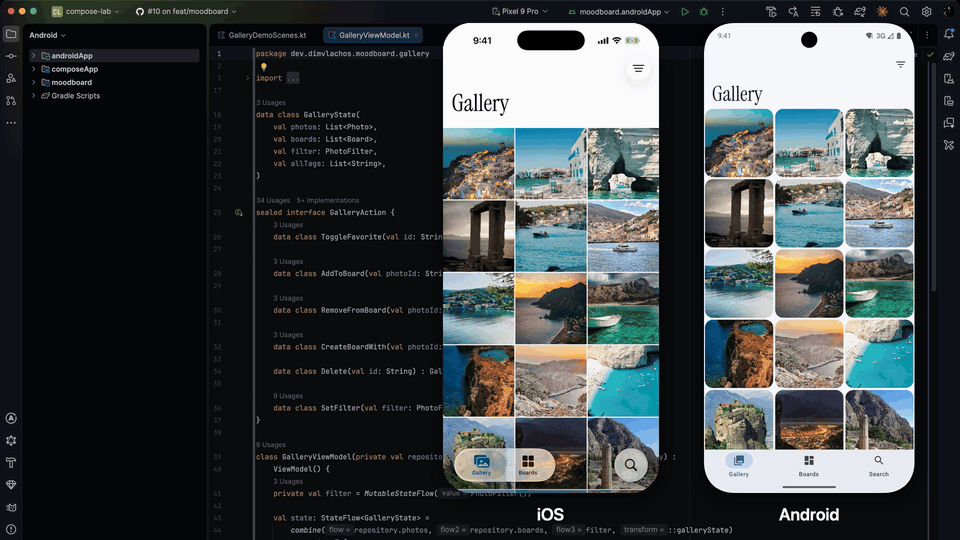

**The point:** the right way to build a Kotlin Multiplatform app is to share what users never see and keep what they touch native. An iPhone user and an Android user should both feel at home: the same app and the same features, with each platform's own components, gestures and motion. Not one UI drawn the same on both.

Moodboard is a photo moodboard (gallery, boards, search) built that way. One Kotlin codebase holds the data, the logic and one MVI ViewModel per screen. Each platform draws its own chrome on top.

| Feature | iOS | Android |
|---|---|---|
| Tabs | Liquid Glass `TabView` that shrinks on scroll, search as its own tab | Material 3 Expressive short navigation bar, cross-fading tabs |
| Screen title | Big title that scrolls with the content, inline title in a glass bar | Large app bar that collapses into a small one |
| Open a photo | System zoom transition from the cell | Container-transform morph from the cell, staying under the bars |
| Inner screens | Native push with swipe back | Parallax push with predictive back |
| Photo menu | `.contextMenu` with a lifted preview | `DropdownMenu` on long press |
| Delete a photo | `.alert` | `AlertDialog` |
| Delete a board | `.confirmationDialog` | `ModalBottomSheet` |
| Filter | Detent sheet | `ModalBottomSheet` (same shared Compose body) |
| Search | `.searchable` with suggestions | Search bar with recent searches and tags first, results as you type |
| Share | `ShareLink` | Share sheet via `FileProvider` |

**What's shared, and what isn't:**

- **Shared** (`moodboard/shared`): the repository, the ViewModels, and three Compose screens with no native-chrome dependency, hosted inside SwiftUI on iOS (photo detail, filter sheet, board editor). SwiftUI observes the ViewModels through [SKIE](https://skie.touchlab.co), so a native toolbar and the hosted Compose content read one state and never disagree.
- **Native on iOS** (`moodboard/iosApp`): a SwiftUI shell for iOS 26. Its grids and lists are SwiftUI so the glass bars, context menus and zoom transition attach to real native views.
- **Native on Android** (`moodboard/androidApp`): Compose with Material 3 Expressive and Navigation 3. Each tab keeps its own back stack, like an iOS `TabView`.
- **One brand across both:** an Aegean blue accent (a full Material scheme on Android, the app tint on iOS), Instrument Serif on the big titles while body text keeps each platform's system font, and one app icon. They read as the same app; neither imitates the other.

Run it:

- Android: `./gradlew :moodboard:androidApp:installDebug`
- iOS: `cd moodboard/iosApp && xcodegen && open Moodboard.xcodeproj` (iOS 26)
- Tests: `./gradlew :moodboard:shared:iosSimulatorArm64Test :moodboard:androidApp:testDebugUnitTest`
- iOS UI walk-through: `xcodebuild -project moodboard/iosApp/Moodboard.xcodeproj -scheme Moodboard -destination 'platform=iOS Simulator,name=iPhone 17 Pro' test` (set `TEST_RUNNER_SCREENSHOT_DIR` to save a screenshot per step)
- The showcase clip: both apps play one 41 s script, step for step.
  - Android: `scripts/moodboard/showcase-android.py out/moodboard-android.mp4` (an emulator records full resolution on the host).
  - iOS: record with `xcrun simctl io booted recordVideo out/moodboard-ios.mov` while running `TEST_RUNNER_SHOWCASE=1 xcodebuild … test -only-testing:MoodboardUITests/ShowcaseUITests`.
  - `scripts/moodboard/showcase-compose.sh out/moodboard-ios.mov <iosStart> out/moodboard-android.mp4 <androidStart> <android-studio.png> out/moodboard.showcase-both.mp4` (each start is the second, in that take, at which its script began: the first scroll), then the GIF at 12 fps and 960 px wide (`scripts/gif.sh` builds the palette in memory, which a 40 s clip can outgrow; ffmpeg's two-pass palettegen/paletteuse makes the same GIF).

## App shell

The lab app around the demos:

- **One bar on every screen.** A shadowed top bar runs up under the status bar on home, in a folder and over each demo, with a back arrow, the title, and Watch/Stop on a demo.
- **Demos open still.** Every demo opens ready to be touched; its scripted tour, the one its clip is recorded from, plays only when **Watch** is tapped, once, with a note over the demo while it runs. Any touch on the demo, or Stop, ends the tour and leaves the demo as it is, to carry on by hand.
- **Search from the bar.** The search button turns the title into a field. It finds demos by title, description, id or tag, including the versions inside a folder, and back closes it.
- **Tags.** A row of chips under home's bar filters the catalog by what each demo is about: Gesture, Physics, Motion, Canvas, 3D, Camera, Text, Navigation.
- **A grid of cards.** Each card has an icon, the title and a one-line description. The grid adds columns as the screen widens.
- **Sound off until you want it.** The app starts silent. A speaker in home's bar turns sound on for the whole app, and the choice is remembered across launches. Each demo's bar has its own speaker, which starts from the app's and changes sound on that screen only. Recordings always keep their sound.
- **System, Light or Dark.** A button in home's bar cycles the theme, and the choice is remembered across launches. The system bars and the window follow it.
- **Portrait and landscape, light and dark.** Every demo works both ways up and in both themes. A demo's surroundings follow the theme, while its art (the paper, the lamp, the book's pages, the photos) looks the same in both.

Recordings always use the dark theme and the portrait layouts, so clips look the same whatever the phone is set to.

## Project structure

```
composeApp/            the components, their demos and the catalog (Kotlin Multiplatform library)
  core/presentation/   components/ (one package each, and topbar/, the shell's bar) and ui/
                       (LabTheme: light and dark colours, type, motion; ThemeMode, SystemBars,
                       StageShape)
  core/demo/           the scripted-demo engine: timed steps, a scripted finger, record mode,
                       DemoTag, and DemoInsets for keeping controls clear of the screen's edges
  *demo/               one package per component: the demos that the clips are recorded from
  catalog/             the list of demos, opened by id (-demo navbar.all) or from the home screen:
                       its screens, the grid and cards, and the search and tag filter
androidApp/            the Android app: one Activity hosting App()
iosApp/                the iOS app: SwiftUI hosting MainViewController (XcodeGen project)
moodboard/shared/      Moodboard's data, logic, ViewModels and shared Compose screens
moodboard/androidApp/  Moodboard on Android: Material 3 Expressive, Navigation 3
moodboard/iosApp/      Moodboard on iOS: SwiftUI for iOS 26, with SKIE-bridged ViewModels
build-logic/           Gradle convention plugins shared by the four modules
scripts/               recording, GIF and texture tools
```

## Run

Requirements:

| Tool | Version |
|---|---|
| JDK | 25 for the Gradle daemon (downloaded automatically if missing); Android code targets Java 17 |
| Android | Android Studio with AGP 9.3 support, compile SDK 37, a device on Android 12 (API 31) or later |
| iOS | macOS with Xcode 26 and [XcodeGen](https://github.com/yonaskolb/XcodeGen); the lab app runs on iOS 16+, Moodboard on iOS 26+ |
| Recording | Python 3 and ffmpeg |

Point Gradle at the Android SDK with `ANDROID_HOME` or `sdk.dir` in `local.properties`.

- Android: `./gradlew :androidApp:installDebug`
- iOS: boot a simulator, then run `scripts/install-ios.sh`
- Tests: `./gradlew :composeApp:jvmTest` runs the shared tests on the JVM in a couple of minutes; `./gradlew :composeApp:iosSimulatorArm64Test` runs them in the iOS simulator, as CI does on `main`
- Architecture (Konsist): `./gradlew :androidApp:testDebugUnitTest`
- Lint: `./gradlew :androidApp:lintDebug`
- Formatting: `./gradlew spotlessApply`

## Record a clip

Every demo plays a timed script that ends where it started, so clips loop cleanly. A clip always plays in the dark theme, whatever the app's theme is set to.

```bash
scripts/record.py android navbar.all              # out/navbar.all-android.mp4 (1080×1350, 60 fps, ≤ 5 MB)
scripts/record.py ios navbar.all
scripts/record.py android navbar.all --label && scripts/record.py ios navbar.all --label
scripts/side-by-side.sh navbar.all                 # out/navbar.all-both.mp4
scripts/gif.sh navbar.all                          # docs/media/navbar.all.gif
scripts/record.py android book.turn --landscape    # a landscape demo: 1920×1080 (Android only)
scripts/record.py android feed.fishing --tall      # a tall demo: 1080×1920
scripts/record.py android smoke.delete --tall --sound   # keeps the phone's sound, through scrcpy (Android, portrait; ringer on)
```

Needs Python 3 and ffmpeg.

## Envelope

The nav bar supports 2–4 tabs, at a minimum slot width of about 64 dp.

The profile gallery shows photos in 2 columns of 4:5 cards. Opening one photo straight from another is not a morph: close to the grid first.

The page-turn book shows a two-page spread, 2:1, each spread one image; for crisp strips, give it images whose width divides by 36. It turns one leaf at a time: a tap while a page is still landing lands it at once and turns the next.

The paper plane carries one message of any length; a bubble up to 264 dp wide comes down within its 0.6 s whatever its length, the plane crossing it faster for a long one. The message field grows to 4 lines, 2 on a short screen, and scrolls past that; only the letters it shows are poured into the button. Messages are dropped from the left, whatever the script's direction.

The pull cord hangs one lamp over a screen it fills. While a new look spreads, the screen is composed twice, once in each look, so its state belongs outside it, scroll position included, and it must paint an opaque background; a switch back before the new look has finished spreading turns its circle round, shrinking it back into the bulb. `across` is measured from the left whatever the layout direction, so a right-to-left screen mirrors it itself, as the demo does; the demo's settings scroll when they don't fit.

The pop-up book's leaves are rigid boards, and its frame is 1.22 times as tall as it is wide. A spread has at most one tab, at the outer edge of its near page; the layout is not mirrored for right-to-left. It takes as many spreads and pieces as you like, but each page and piece is a bitmap painted for the book's size, so a book of many spreads holds many bitmaps. Only the spread the book is turned to is saved: tabs and sails start again at rest.

The typewriter composer's sheet takes 18 letters to a line and 4 lines, 72 letters at most, and what does not fit is refused, not scrolled. Its keys are a fixed QWERTY set with one page of figures and stops: no accents, no other scripts, no emoji, and a hardware key it has no key for types nothing. It types left to right only. Each sheet is one message.

The smoke delete cuts a row into about 2,600 particles, at most 3,000, and fewer for a new row while more than 11,000 are in the air, so a wave of rows thins out rather than slowing down; a row is sampled from a drawing of at most 2 million pixels, a bigger one from a smaller copy. Every row of a list goes up in the one overlay, keyed by the caller's key, which must be unique in the list. A row's colours are cut down to 8. The smoke is drawn over the whole overlay, so it rises over a header above the list, though a row's hidden part makes none. Nothing about the smoke is saved: a screen made again starts with its rows whole.

The card file takes any number of cards, dividers included, and composes about nine at a time. A divider can't be pulled out, a deck of one card doesn't spin, and an empty deck shows the empty file. Which card is out and where the wheel stands are not saved.

The bookshelf's ring takes as many books as you like and draws those within reach of the front; a plank takes at most nine. A book being read opens at a chapter set from its words, one chapter at a time, and a book not begun at its title page. The open page is a picture of its text, not text you can select. Which book is out and the page it is open at are not saved, and the layout is not mirrored for right-to-left.

The star stickers rate from 0 to 5 in whole stars. The rating lays itself out for its width: its height is fixed, 196 dp, and a star flies up to about 26 dp above it, so leave room over the row. `rememberStarStickerState()` keeps the score when the screen is made again, its stars already pressed in.
The padlock's strength scoring is a placeholder: length, the kinds of character and a short list of common passwords, in five levels. A real app would score as zxcvbn does and map it onto the same levels. The lock is drawn in a 300 × 250 box scaled to its space, no more than 1.35 times, and is not mirrored for right-to-left.
The pencil cup holds four tools; its fan is laid out for a phone held upright, from the bottom-right corner, and is not mirrored for right-to-left. The cup draws over the screen it fills, so place it over the list it belongs to.

The locket holds one of the four Recent photos it draws itself; a real app would pass its own pictures and crop the stored image to the oval. It is drawn in a 300 × 380 box scaled to its space, no more than 1.45 times, with the Recent strip never below its dp size, and is not mirrored for right-to-left. Which photo is in the locket is not saved.

The birdcage is drawn in a 300 × 290 box scaled to its space, no more than 1.5 times, standing on the bottom of it, and is not mirrored for right-to-left. The canary breathes and the cloth ripples all the time, so its frame loop runs while the screen is in front. How long a chat stays muted is the app's to decide.

The key rack's hooks share one board, which suits about four people, each with two or three things on their ring: keys, a fob, a leather tag or a bobber. It fills its space, with the account card's 62 dp at its top, and its keys grow with the height it is given. Who is signed in is not saved, and the rack is not mirrored for right-to-left.

The paper fan prints an answer of a sentence or two: the type steps down from 13 to 10.5 px to fit the half ring, and an answer longer than that is not printed (it is still read out). The fan is sized to its card, between 110 and 172 dp across its radius, the list is a plain scrolling column rather than a lazy one, and the fan is not mirrored for right-to-left.

The paint roller takes five paints and up to seven wet fills, laid out for a phone held upright: the roller is 56 % of the screen's width, so the wall is two strokes wide, and the screen it paints must fit above the trays without scrolling. The new coat is a second composition of the screen, so its state (the switches here) belongs outside it. Which colour is chosen is not saved, and the layout is not mirrored for right-to-left.

The sticky notes keep the prototype's fixed list of six: rows grow from 54 to 96 dp to fill the height, and a list longer than the screen doesn't scroll. A note put back goes to the index it left from, so notes put back out of order can change places. A pad shows its last four notes. The notes, the pads and what is on them are not saved, and the layout is not mirrored for right-to-left.

The French press shows one story: the words that fly are those on the screen, the rest of the article stays still under the fade above the press, and the story doesn't scroll. The summary is fixed text, not generated. The layout is not mirrored for right-to-left.

## Contributing

Issues and pull requests are welcome. [CONTRIBUTING.md](CONTRIBUTING.md) has the checks CI runs and the commit style.

## Licence

MIT. Icon path data comes from Material Icons (Apache 2.0). On Android, the fogged mirror finds you in the camera with Google's [ML Kit selfie segmentation](https://developers.google.com/ml-kit/vision/selfie-segmentation), on the phone; the app has no internet permission, so nothing it sees leaves the phone.

The page-turn book's pages are Winsor McCay's *Little Nemo in Slumberland*, the New York Herald Sunday pages of 15 October 1905 to 4 February 1906 (1905-12-03 from a smaller scan, 1906-01-28 left out), public domain, from the scans on [Wikimedia Commons](https://commons.wikimedia.org/wiki/Category:Little_Nemo_in_Slumberland).

Photos from [Unsplash](https://unsplash.com), used under the [Unsplash licence](https://unsplash.com/license) (the island photos are also bundled in the Moodboard):

| Photo | Photographer |
|---|---|
| [Portrait](https://unsplash.com/photos/DItYlc26zVI) | Christian Buehner |
| [Corfu](https://unsplash.com/photos/vhRn4aDempw) | Tobias Reich |
| [Paxos](https://unsplash.com/photos/bs1aa6L9rPM) | Luke Moss |
| [Santorini](https://unsplash.com/photos/6N2mSJsKTtA) | James Ting |
| [Milos](https://unsplash.com/photos/0lq90N_B1XE) | Despina Galani |
| [Naxos](https://unsplash.com/photos/dGD7R9R4ZiI) | Sebastiano Corti |
| [Hydra](https://unsplash.com/photos/jfnTAhvysZI) | Despina Galani |
| [Mykonos](https://images.unsplash.com/photo-1601581875309-fafbf2d3ed3a) | Johnny Africa |
| [Crete](https://images.unsplash.com/photo-1575237402880-4b496a83ae04) | Joshua Kettle |
| [Rhodes](https://images.unsplash.com/photo-1572375901777-1b257481cbb0) | Vlad Kiselov |
| [Zakynthos](https://images.unsplash.com/photo-1612279427382-f8349a383af8) | Julian Timmerman |
| [Kefalonia](https://images.unsplash.com/photo-1598959594958-34761147b7b0) | Mac McDade |
| [Folegandros](https://images.unsplash.com/photo-1688765866663-0fd353e7d5df) | Tom Waldek |

Photos from [Pexels](https://www.pexels.com), used under the [Pexels licence](https://www.pexels.com/license/):

| Photo | Photographer |
|---|---|
| [Houseplants in pots standing in a bathtub](https://www.pexels.com/photo/15618010/) (the bathroom in the fogged mirror: on its own, or behind you, cut out of the camera) | nana |
| [Contemporary bathroom interior with mirror above washbasin at home](https://www.pexels.com/photo/7046159/) (the wall the fogged mirror hangs on, extended with more tiles above and a counter front below) | Max Vakhtbovych |
| [Water droplets on foggy glass](https://www.pexels.com/photo/water-droplets-on-foggy-glass-8628343/) (the fog's condensation, via `scripts/fog-texture.py`) | Chris F |

The typewriter composer's face is [Special Elite](https://fonts.google.com/specimen/Special+Elite), Copyright (c) 2010 Brian J. Bonislawsky DBA Astigmatic (AOETI) (Apache License 2.0, licence bundled at `composeApp/src/commonMain/composeResources/files/licenses/SpecialElite-Apache-2.0.txt`).

The card file's faces are [Courier Prime](https://github.com/quoteunquoteapps/CourierPrime), Copyright 2015 The Courier Prime Project Authors, [Caveat](https://github.com/googlefonts/caveat), Copyright 2014 The Caveat Project Authors, and [Archivo](https://github.com/Omnibus-Type/Archivo), Copyright 2020 The Archivo Project Authors (SIL Open Font License 1.1, licences bundled at `composeApp/src/commonMain/composeResources/files/licenses/`; Caveat and Archivo are static instances, at weights 600 and 800, of the variable fonts).

The bookshelf's faces are [Instrument Serif](https://github.com/Instrument/instrument-serif), Copyright 2022 The Instrument Serif Project Authors, and [Instrument Sans](https://github.com/Instrument/instrument-sans), Copyright 2022 The Instrument Sans Project Authors (SIL Open Font License 1.1, licences bundled at `composeApp/src/commonMain/composeResources/files/licenses/`).

The sticky notes are handwritten in the card file's [Caveat](https://github.com/googlefonts/caveat), at weight 600 (SIL Open Font License 1.1, licence bundled at `composeApp/src/commonMain/composeResources/files/licenses/Caveat-OFL.txt`).

The French press's story is set in [PT Serif](https://www.paratype.com/fonts/pt/pt-serif), Copyright 2010 ParaType Ltd., and its small caps in [JetBrains Mono](https://github.com/JetBrains/JetBrainsMono) Regular and SemiBold (SIL Open Font License 1.1, licences bundled at `composeApp/src/commonMain/composeResources/files/licenses/`).

The star stickers' sheet is printed in [JetBrains Mono](https://github.com/JetBrains/JetBrainsMono), Copyright 2020 The JetBrains Mono Project Authors (SIL Open Font License 1.1, licence bundled at `composeApp/src/commonMain/composeResources/files/licenses/JetBrainsMono-OFL.txt`).

The locket's engraving is in [Great Vibes](https://github.com/googlefonts/great-vibes), Copyright 2015 The Great Vibes Pro Project Authors, and [Cormorant Garamond](https://github.com/CatharsisFonts/Cormorant), Copyright 2015 the Cormorant Project Authors (SIL Open Font License 1.1, licences bundled at `composeApp/src/commonMain/composeResources/files/licenses/`; Cormorant Garamond Italic is a static instance, at weight 500, of the variable font).
The zipper's tag letter is set in [Gelasio](https://github.com/SorkinType/Gelasio), Copyright 2022 The Gelasio Project Authors (SIL Open Font License 1.1, licence bundled at `composeApp/src/commonMain/composeResources/files/licenses/Gelasio-OFL.txt`; a static instance, at weight 700, of the variable font).
The paper fans' answers are printed in [Gelasio](https://github.com/SorkinType/Gelasio), Copyright 2022 The Gelasio Project Authors (SIL Open Font License 1.1, licence bundled at `composeApp/src/commonMain/composeResources/files/licenses/Gelasio-OFL.txt`; static instances, at weights 400 and 700, of the variable font).

The Moodboard's display face is [Instrument Serif](https://github.com/Instrument/instrument-serif) (SIL Open Font License 1.1, licence bundled at `moodboard/shared/src/commonMain/composeResources/files/licenses/`).

The Moodboard's mainland photos are from [Wikimedia Commons](https://commons.wikimedia.org), cropped to 640×800. The cropped files (`moodboard/shared/src/commonMain/composeResources/files/photos/photo_{meteora,meteora_night,delphi,acropolis,nafplio,monemvasia,vikos,kalogeriko}.jpg`) stay under the Creative Commons licence listed for each, not the repo's MIT licence:

| Photo | Author | Licence |
|---|---|---|
| [Meteora](https://commons.wikimedia.org/wiki/File:Meteora_Agios_Triadas_IMG_7632.jpg) | Dido3 | [CC BY-SA 3.0](https://creativecommons.org/licenses/by-sa/3.0) |
| [Meteora at Night](https://commons.wikimedia.org/wiki/File:%CE%9C%CE%B5%CF%84%CE%B5%CF%89%CF%81%CE%B1_by_night.jpg) | Argiriskaramouzas | [CC BY-SA 4.0](https://creativecommons.org/licenses/by-sa/4.0) |
| [Delphi](https://commons.wikimedia.org/wiki/File:Delphi_BW_2017-10-08_11-49-24.jpg) | Berthold Werner | [CC BY-SA 3.0](https://creativecommons.org/licenses/by-sa/3.0) |
| [Acropolis](https://commons.wikimedia.org/wiki/File:Akropolis_fra_Pnyx_2017_(1).jpg) | Peulle | [CC BY-SA 4.0](https://creativecommons.org/licenses/by-sa/4.0) |
| [Nafplio](https://commons.wikimedia.org/wiki/File:%CE%9D%CE%B1%CF%8D%CF%80%CE%BB%CE%B9%CE%BF_7834.jpg) | C messier | [CC BY-SA 4.0](https://creativecommons.org/licenses/by-sa/4.0) |
| [Monemvasia](https://commons.wikimedia.org/wiki/File:%CE%9C%CE%BF%CE%BD%CE%B5%CE%BC%CE%B2%CE%B1%CF%83%CE%B9%CE%AC_0412.jpg) | C messier | [CC BY-SA 4.0](https://creativecommons.org/licenses/by-sa/4.0) |
| [Vikos Gorge](https://commons.wikimedia.org/wiki/File:Vikos_Gorge_(%CE%A6%CE%B1%CF%81%CF%81%CE%AC%CE%B3%CE%B3%CE%B9_%CF%84%CE%BF%CF%85_%CE%92%CE%AF%CE%BA%CE%BF%CF%85)_by_Pudelek_2.JPG) | Pudelek | [CC BY-SA 4.0](https://creativecommons.org/licenses/by-sa/4.0) |
| [Kalogeriko Bridge](https://commons.wikimedia.org/wiki/File:Old_Bridge_Kalogeriko.jpg) | Jolovema | [CC BY-SA 4.0](https://creativecommons.org/licenses/by-sa/4.0) |

---

<p align="center">If a component here helped you, a ⭐ helps others find it.</p>
